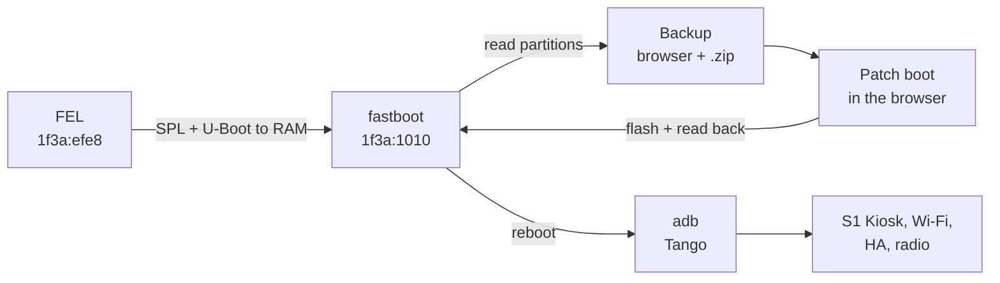

# How we got here

This is the engineering story behind S1 Unleashed: how a sealed Aqara wall panel became an open
Home Assistant device that installs from a browser. The front page says *what* it does. These
notes say *how* it works and *how we found out*, with the evidence.

You don't need any of this to use the project. It's here for people who want to check the
work, extend it, or port it to another panel.

<p align="center">
  
</p>

**Contents**

1. [A panel that was more open than it looked](#1-a-panel-that-was-more-open-than-it-looked)
2. [Finding the way in: FEL](#2-finding-the-way-in-fel)
3. [Mainline U-Boot, and the DRAM bug](#3-mainline-u-boot-and-the-dram-bug)
4. [Persistent root with Magisk](#4-persistent-root-with-magisk)
5. [The installer, moved into the browser](#5-the-installer-moved-into-the-browser)
6. [Making it a good wall panel](#6-making-it-a-good-wall-panel)
7. [The radio](#7-the-radio)
8. [The wall base](#8-the-wall-base)
9. [The research notes](#the-research-notes)

---

## 1. A panel that was more open than it looked

The S1 Plus is an Allwinner A133 board running Android 10, with an Aqara launcher on top. The
first step was the panel's 3-pin debug UART: 3.3 V, 115200 8N1, reached through flat pads that
need a firm or soldered contact. An ESP32-S3 served as the USB-to-UART bridge
([`tools/esp32-uart-bridge`](../../tools/esp32-uart-bridge)).

The stock boot log, captured over that console, showed how little was locked down:

```
secure enable bit: 0                                  ← secure boot off
tool did not set rotpk burn flag, skip rotpk burn     ← no root-of-trust key fused
magic = AVB0 ... release tool = avbtool 1.1.0         ← verified boot present, not enforced
```

A root shell confirmed the rest: SELinux was permissive, an AOSP `su` shipped in
`/system/xbin`, and the build was `test-keys`. The chip would boot unsigned code. The
remaining question was how to reach it without a serial cable.

→ [hardware.md](../../frames/aqara-s1-plus/research/hardware.md) · [boot-log.md](../../frames/aqara-s1-plus/research/boot-log.md) · [findings.md](../../frames/aqara-s1-plus/research/findings.md)

## 2. Finding the way in: FEL

Every Allwinner SoC has **FEL**, a USB recovery mode in mask ROM. It can't be erased, and on
this panel it isn't authenticated. That makes the panel very hard to brick for good: you can
always get back into FEL.

Before settling on FEL, which needs a button on the board, we looked hard for a way in with no
button. The stock U-Boot opens a USB gadget on every boot (`usb burn from boot`). Reading the
BSP source showed it is a **key-burning** mode: it has a ~700 ms window, vendor SCSI opcodes,
and no way to flash partitions. Every other route (`efex` via `misc`, the RTC FEL flag,
`auto_fel`) needs root on the panel first. So the PCB button became the one physical step:
open the back cover, hold the button, plug in USB-C.

→ [findings.md: Bootloader USB entry points](../../frames/aqara-s1-plus/research/findings.md#bootloader-usb-entry-points-stock-u-boot-201805-read-from-the-binary)

## 3. Mainline U-Boot, and the DRAM bug

To flash anything over USB, we needed our own bootloader running from RAM. That meant mainline
U-Boot with a board config for the panel, using the real DRAM parameters read from the stock
BOOT0 header (DDR4, 792 MHz, 1200 mV, AXP806 PMIC).

It "worked": 2 GiB came up and passed every write-then-read test. Then real code crashed at
random. TF-A hit undefined instructions on valid opcodes, `memcpy` hung, and crash dumps came
out garbled. A copy loop (load from one address, store to another) found the pattern: about
**300 corrupted 64-bit words per MiB**, all on read→write bus turnarounds.

To find the cause, we diffed the DRAM controller registers two ways: as our SPL programmed
them (read over FEL), and as stock boot0 programmed them (read from Android through
`/sys/class/sunxi_dump`). Six differences stood out:

| Register | Mainline | Stock | Why it mattered |
|---|---|---|---|
| MR0 (`INIT3` + MRS) | `0x840` | `0x520` | The RAM ran a different CAS latency than the controller assumed |
| `MSTR` bit 0 | geardown on | off | The DRAM's own MR3 has geardown off |
| `INIT7` (MR6) | `0x826` | `0x862` | A typo |
| `DRAMTMG6` | `0x00000005` | `0x02020005` | `0x20 << 16` truncated to 0 |
| `ADDRMAP1`/`ADDRMAP8` | `0x1f` | `0x3f` | "Disabled" in 6-bit fields |
| `SCHED[3:0]` | `0x1` | `0x5` | |

With all six matched to stock, everything booted. A bisect then showed that **MR0 alone is
the fix**: without it, U-Boot hangs even with the other five changes; with only MR0, a copy test
of 16 MiB passes 12 times out of 12. The other five just match boot0. This likely affects every
A133 board with DDR4, so the MR0 fix goes upstream as a single patch. Three smaller fixes
followed:

- **CPU clock.** The CPU is pinned to 408 MHz, because there is no SPL driver for the AXP806.
- **USB uploads.** These go in 64 KiB chunks, because the boot ROM's USB is slow at that clock.
- **No TF-A.** U-Boot runs straight at EL3 for now.

Then came fastboot over USB-C, plus a small `upload` extension to **read** partitions back
at about 20 MB/s.

→ [fel.md](../../frames/aqara-s1-plus/research/fel.md) · patches in [`frames/aqara-s1-plus/tools/fel/uboot/patches`](../../frames/aqara-s1-plus/tools/fel/uboot/patches)

## 4. Persistent root with Magisk

The radio modes need a root service, and the stock image makes that awkward:

- adbd drops the capabilities that Aqara's `su` needs.
- The boot ramdisk is first-stage only.
- Changing `system` would mean rebuilding `super`.

Magisk changes only `boot`, and its `overlay.d` injects an init service into second-stage
init. That is exactly what the S1 root helper needs. The app never gets `su`; it only sets
properties, and the init service does the root work.

- **AVB.** It turned out not to matter. The panel already boots a `vbmeta` with verification
  disabled, even while it reports `locked`, so a patched `boot` just boots.
- **First boot.** A one-shot service authorises the installing computer's adb key, which is
  baked into the image, so adb comes up with no taps on the screen.
- **Factory simulation.** We wiped the reference panel back to factory state: adb off, keys
  cleared, stock `boot`, factory `vbmeta`. One command then installed and verified everything,
  and adb was back 21 s after reboot. Re-running on a patched panel produces the identical
  image.

→ [root.md](../../frames/aqara-s1-plus/research/root.md)

## 5. The installer, moved into the browser

The CLI chains `sunxi-fel`, `fastboot`, Docker and `adb`. The web installer does the same in
one page, over WebUSB:



- **FEL over WebUSB.** A TypeScript port of the subset of `sunxi-fel` we use: `ver`, `spl` and
  `reset64`, uploading in chunks.
- **fastboot.** Our gadget, plus the partition-read extension.
- **A byte-exact Magisk patch.** This was the hard part. magiskboot compresses with specific
  Rust crates (`zlib-rs` at level 9, `lzma-rust2` with an ARM Thumb BCJ filter), and neither
  the browser's gzip nor liblzma produces the same bytes. So those exact pinned crates are
  compiled to WebAssembly. The browser's output matches the CLI's Docker patch byte for byte,
  and the tests check it against golden images from the CLI.
- **adb over WebUSB.** Tango (ya-webadb) installs the app and configures the panel. Wi-Fi
  credentials go over Improv Serial through adb.

The UI went through five mockups before *option E*, the one that shipped.

<p align="center">
  
</p>

→ [web-installer.md](../../frames/aqara-s1-plus/research/web-installer.md) (the design spec, written before the build) · [`kiln/`](../../kiln/src/README.md)

## 6. Making it a good wall panel

- **A browser that can run Home Assistant.** The system WebView is Chromium 74. GeckoView ships
  its own current engine, so S1 Kiosk is built on it.
- **The screen that turned itself off.** At night the panel kept going dark, and it looked like a
  kiosk bug. It was Aqara's system manager: a hidden Do Not Disturb rule from 22:00 to 07:00
  forces the screen off 15 s after every wake. The panel had also shipped in the
  `Africa/Algiers` time zone. The installer now turns that rule off through Aqara's own binder API,
  and the kiosk runs its own night mode, using the panel's time-of-flight and light sensors.
  → [screen-policy.md](../../frames/aqara-s1-plus/research/screen-policy.md) · [../sensors.md](../../frames/aqara-s1-plus/docs/sensors.md)
- **Aqara's cloud.** Disabling Aqara's apps didn't stop it phoning home. A native daemon,
  `ha_master`, kept the cloud link up. A watchdog in Aqara's system manager also forced a Wi-Fi
  reassociation whenever that link dropped. The kiosk stops the daemon at start, and the panel
  then holds no internet connections. → [debloat.md](../../frames/aqara-s1-plus/research/debloat.md)
- **Voice.** openWakeWord runs on the panel with TFLite. The ESPHome native API makes the panel an
  Assist satellite, and the *Ambient Stage* overlay shows the conversation.

<p align="center">
</p>

## 7. The radio

The panel's 802.15.4 radio is a Silicon Labs EFR32. It sits on SPI and runs **multi-PAN RCP**
firmware over CPC. Aqara's stack is
`cpcd → zigbeed (spinel IID 1) → EZSP → Z3Gateway → MQTT`.

- **Zigbee coordinator.** Keep Aqara's `cpcd` and `zigbeed`, and bridge EZSP to TCP so that
  ZHA on Home Assistant drives the radio over the network.
- **Thread.** OpenThread's `otbr-agent`, cross-built for the panel, talks to the same RCP on the
  free spinel IID 2. A full border-router build is still in progress, so this mode is
  **experimental**.
- **Routers.** Zigbee router and Thread router modes shipped in 0.3.0 and joined a real home network on 2026-11-10 (experimental).
- **Deliberately not offered:** Zigbee and Thread at the same time on one radio. They would share
  a channel, and Home Assistant deprecated the same multiprotocol design on its own hardware.

The radio's firmware flash path was proven by reflashing the identical stock RCP image.

→ [../radio.md](../../frames/aqara-s1-plus/docs/radio.md)

## 8. The wall base

The mains relay base talks to the panel over `/dev/ttyS3`. Its protocol was reverse-engineered
from Aqara's `bracket_cli` and `libha_bracket.so`, which are 32-bit ARM, stripped, and read with
`llvm-objdump` and radare2.

To check the result, we wrote an emulator from that reading and ran **Aqara's own `bracket_cli`
against it on the panel**. Aqara's tool accepted it. The kiosk's native driver passes the same
test, but it has **not yet met a real base**.

→ [bases.md](../../frames/aqara-s1-plus/research/bases.md) · [base-protocol.md](../../frames/aqara-s1-plus/research/base-protocol.md)

---

## The research notes

This page is the index of every note. Notes about one device live with its frame, in
`frames/<id>/research/`; notes that apply to every frame live here, in `docs/research/`.

### General (`docs/research/`)

| File | What's in it |
|---|---|
| [bringup.md](bringup.md) | The method: how to break into a device step by step, and what the S1 taught us about FEL, U-Boot, fastboot and Android 10 |
| [TEMPLATE.md](TEMPLATE.md) | Start a new note from this |
| [microwakeword.md](microwakeword.md) | Replacing openWakeWord with microWakeWord: the Kotlin port of TFLite Micro's audio frontend, the models, test speech, and what is left for the panel |
| [android-ca-roots.md](android-ca-roots.md) | Which CA roots Android 6 and 7.0 lack for GitHub's download hosts (ISRG Root X1), checked against AOSP's stores, and the bundled root that fixes the wake word download and updates there (#456) |
| [gecko-turn.md](gecko-turn.md) | Gecko won't use a TURN server at a loopback IP or a relayed candidate on loopback (Chrome does): why the S1 never connected to Clarity's WebRTC camera, and the fix (#202) |
| [ha-esphome-actions-events.md](ha-esphome-actions-events.md) | What a notification can carry over ESPHome each way: why `notify` takes one JSON `data` argument, and why a tapped button goes to HA as a bus event, not an event entity (#118) |
| [camera-presence.md](camera-presence.md) | Which detector wakes the screen from a camera: ML Kit and a person model weighed, then the maintainer's lighting-insensitive motion detector chosen (#117) |
| [onvif-rtsp.md](onvif-rtsp.md) | What HA's ONVIF integration and UniFi Protect need from a camera, the libraries weighed, the maintainer's tested RTSP and ONVIF server that Glassworks ports, and HA's pull loop on a refused sign-in, with a lab to rerun it (#117) |
| [kiln-gpl-code.md](kiln-gpl-code.md) | Which code in Kiln's MIT page comes from GPL projects: sunxi-tools in `kiln/packages/fel`, Magisk in `kiln/packages/bootpatch`, checked word by word and against the live site, with the options (open, a maintainer decision) |
| [kiln-cleanroom/](kiln-cleanroom/README.md) | The clean-room rewrite of Kiln's GPL-derived FEL and boot patch code (#355): the rules, a behaviour spec for each package, and the black-box test vectors |
| [pane-blueprints.md](pane-blueprints.md) | How a pane's blueprints reach Home Assistant without the panel writing to it: HA's admin-only blueprint API, the import and list links, the name an import gets, and HA's own check of the four blueprints, with a script to rerun it |
| [legacy-engine.md](legacy-engine.md) | The frozen GeckoView 144 on Android 6–7 (API 23–25): what runs, the API diff against 159, APK size per ABI, and the lockdown to the panel's Home Assistant, verified on emulators and the Mirror; the legacy build of the app starts on the Mirror and loads the dashboard (2026-11-17) (#198) |
| [setup-hotspot-portal-and-name.md](setup-hotspot-portal-and-name.md) | The setup hotspot (#197): what a captive portal and a `Glassworks` network name would take on the S1 (root), generic Android and the Mirror. Read from AOSP and Android's reference, and the S1 run of 2026-11-16 |
| [ci-emulator-api34.md](ci-emulator-api34.md) | Why `conformance (API 34)` died mid-test: qemu segfaults under `swiftshader_indirect`, and the permission dialog paused MainActivity. Core dumps, the dead ends (memory, rotation) and the pass rates before and after |

### Aqara S1 Plus ([`frames/aqara-s1-plus/`](../../frames/aqara-s1-plus/README.md#research-notes))

| File | What's in it |
|---|---|
| [hardware.md](../../frames/aqara-s1-plus/research/hardware.md) | Board, SoC, FEL button, the 3-pin UART console and an ESP32-S3 as the adapter |
| [boot-log.md](../../frames/aqara-s1-plus/research/boot-log.md) | Annotated stock boot log: BOOT0 DRAM bring-up, secure-boot state, partitions |
| [findings.md](../../frames/aqara-s1-plus/research/findings.md) | Root, SELinux, AVB, partitions, USB/adb defaults; why there is no button-free USB entry |
| [fel.md](../../frames/aqara-s1-plus/research/fel.md) | Mainline U-Boot from FEL: the A133 DDR4 fix, CPU clock, chunked uploads, fastboot |
| [root.md](../../frames/aqara-s1-plus/research/root.md) | Persistent root with Magisk, the root helper, first-boot adb provisioning, `fel-install.sh` |
| [web-installer.md](../../frames/aqara-s1-plus/research/web-installer.md) | The WebUSB installer's design spec: FEL port, fastboot, byte-exact boot patch, per-OS setup |
| [screen-policy.md](../../frames/aqara-s1-plus/research/screen-policy.md) | Why the panel turned its screen off (Aqara's DND night rule) and what replaced it |
| [debloat.md](../../frames/aqara-s1-plus/research/debloat.md) | Aqara's packages, the reversible de-bloat, and the cloud daemon and its Wi-Fi watchdog |
| [bases.md](../../frames/aqara-s1-plus/research/bases.md) | Which wall bases exist, how the panel talks to them, the kiosk's driver |
| [base-protocol.md](../../frames/aqara-s1-plus/research/base-protocol.md) | The wall base UART protocol, with the emulator proof against Aqara's own tool |
| [zigbee2mqtt.md](../../frames/aqara-s1-plus/research/zigbee2mqtt.md) | Zigbee2MQTT on the stock radio: Silicon Labs' zigbeed 8.2.2 on Aqara's RCP, panel tests, licences |
| [rcp-firmware.md](../../frames/aqara-s1-plus/research/rcp-firmware.md) | Could a newer multiprotocol RCP be built for this MG21? CPC protocol, tooling, board config |
| [framework-restart.md](../../frames/aqara-s1-plus/research/framework-restart.md) | Android 10's ActivityManager breaking during fast kiosk restarts, and `system_server` restarting; the likely (untested) cause of the panel "dropping off USB" |
| [boot-animation.md](../../frames/aqara-s1-plus/research/boot-animation.md) | What Android 10's boot animation and the 32 MiB boot image allow: texture caching, trim, the size budget, and what was cut from the #63 design |
| [idle-cpu.md](../../frames/aqara-s1-plus/research/idle-cpu.md) | Why the kiosk uses ~40% of a core at idle: the wake word's embedding model, per-thread numbers, and the options (#105) |
| [webrtc-camera.md](../../frames/aqara-s1-plus/research/webrtc-camera.md) | A real camera over WebRTC in GeckoView on the S1: it plays, very likely with software decoding (Gecko's FFmpeg) where HLS gets the hardware decoder (#202) |
| [bluetooth.md](../../frames/aqara-s1-plus/research/bluetooth.md) | The panel's Bluetooth (RTL8821CS, shared with Wi-Fi), Android 10's scan rules from AOSP, and what HA needs from an ESPHome Bluetooth proxy (#121) |
| [view-open.md](../../frames/aqara-s1-plus/research/view-open.md) | Where typical's 4.7 s view open goes: HA's JavaScript on one Gecko thread at 1.5 GHz; the app candidates tried on the panel (none helped), and what's left upstream (#244) |
| [install-crash-loop.md](../../frames/aqara-s1-plus/research/install-crash-loop.md) | Why the kiosk crash-looped after installs: Android 10's ActivityManager LRU bug (one step per kiosk force-stop), not dex2oat; the netwatch check that restarts the framework (#248) |
| [frame-loader.md](../../frames/aqara-s1-plus/research/frame-loader.md) | Frame updates on the S1 (#139, #528): `/data` at `post-fs-data`, fixed service slots, the frame bundle and its names, and a Kiln update without opening the panel through the stock U-Boot's fastboot (read, panel tests pending) |

### lululemon Studio Mirror ([`frames/lululemon-mirror/`](../../frames/lululemon-mirror/README.md#research-notes))

| File | What's in it |
|---|---|
| [mirror-android.md](../../frames/lululemon-mirror/research/mirror-android.md) | Can the lululemon Mirror run Android 8+ for the current GeckoView? The signed boot image blocks it; the kexec idea, the paths, blobs and read-only probes (desk research, #39) |
| [revisions.md](../../frames/lululemon-mirror/research/revisions.md) | Which Mirror revisions are a target: the later NXP i.MX8 revisions (only JTAG access reported), and why screen size doesn't identify it (read, no hardware) |
| [mirror-abis.md](../../frames/lululemon-mirror/research/mirror-abis.md) | Which ABIs the Mirror's userspace runs: 64-bit in the community image, stock untested (#98) |
| [home-app.md](../../frames/lululemon-mirror/research/home-app.md) | How adb without root makes S1 Kiosk the Mirror's home screen on Android 6: no `cmd`, so Android's chooser and an Always tap (read-only probes, 2026-11-15) |
| [image-patch.md](../../frames/lululemon-mirror/research/image-patch.md) | What Kiln changes in the community system image (the app as a priv-app with its libraries: the S1 Kiosk probe in the 2026-11-16 flash, now the legacy build of Glassworks, which runs on the Mirror since 2026-11-17; the boot animation; `ro.sf.hwrotation` until 2026-11-17, which nothing on the image reads, so the first boot sets `user_rotation=3` instead) and what a fresh userdata needs for Kiln's own adb key; first flashed on a real Mirror on 2026-11-16: boots, takes the adb key; the boot animation rendered sideways (hwrotation doesn't turn it) and the test APK has no home screen (#40) |
| [first-boot.md](../../frames/lululemon-mirror/research/first-boot.md) | How a fresh userdata comes up with nothing to tap: Wi-Fi on with the network saved (wpa_supplicant.conf, PSK only), no screen timeout, no lock screen (`ro.lockscreen.disable.default`), no auto-rotate, through a SettingsProvider overlay in /vendor/overlay; read from AOSP 6.0.1 and the image, verified on the unit 2026-11-16 (#29) |
| [community-image-terms.md](../../frames/lululemon-mirror/research/community-image-terms.md) | May Kiln download and modify the community system image? No licence for its vendor binaries, no CORS; open for the maintainer (#40) |
| [mirror-root.md](../../frames/lululemon-mirror/research/mirror-root.md) | Can we root the Mirror dev unit cheaply and safely? The AOSP `su` route is a dead end (user boot image, enforcing, no `su` domain); a platform test-key app gives uid system / `system_app` with no flash; three `system`-only leads stay open (a custom `.ko`, re-enabling `flash_recovery`, hooking `post_boot.sh`). Nothing flashed (#40) |
| [privileged-app.md](../../frames/lululemon-mirror/research/privileged-app.md) | Does an app in `/system/priv-app` get Android 6's privileged permissions (`INSTALL_PACKAGES`, `REBOOT`, `WRITE_SECURE_SETTINGS`) whatever its key, and keep them after it updates itself? Yes: read from AOSP 6.0.1's `PackageManagerService`, verified on the unit with a probe app (`tools/mirror/probe-app`, 2026-11-16). Whether it can approve a computer's adb key (`MANAGE_USB`, `allowUsbDebugging`): read; `MANAGE_USB` and the `usb` service verified on the unit (read-only), the approval untested (#29) |
| [adbd-keys.md](../../frames/lululemon-mirror/research/adbd-keys.md) | Why doesn't adbd accept a key from `/data/misc/adb/adb_keys`? The stock lululemon boot's adbd most likely doesn't verify a connection against that file (it defers to the framework, which the Glass Panes image rebuilt to auto-approve one fingerprint). The AOSP 6.0.1 key-loading timing is ruled out and SELinux is ruled out by the policy (every path component is allowed); a malformed key file is narrowed, not ruled out, since the file's bytes weren't read. So the `services.jar` rewrite (#426) is the only lever Kiln has without the boot partition, which it never writes (read/inferred from AOSP source and the pulled policy and log, 2026-11-16, #29) |
| [mirror-memory.md](../../frames/lululemon-mirror/research/mirror-memory.md) | Why Glassworks "crashes" on the Mirror: the lowmemorykiller at memory status critical, not a crash. The memory budget from the Mirror's own logs, why GeckoView 144's GPU process dies when the app leaves the front, and what the app and the image cut, measured on an Android 6 emulator (2026-11-18) |

### Generic Android ([`frames/generic-android/`](../../frames/generic-android/README.md))

| Note | Question |
|---|---|
| [kiln-install.md](../../frames/generic-android/research/kiln-install.md) | Which adb commands install Glassworks, grant it what it needs and set the home screen on Android 6, 7 and 8+, and what tells Kiln a device's brand before USB debugging is on (read, untested on a device, #403) |

User-facing guides stay one level up, in [docs/](../README.md).

### Ground rules for these notes

- No device-unique values: no serials, MACs, EUI64s, keys or PAN IDs. They are redacted wherever
  a log contained them.
- No Aqara binaries or firmware in the repository. Backups and dumps stay off-repo.
- Every claim is something we ran or read. Where something is untested, the note says so.
