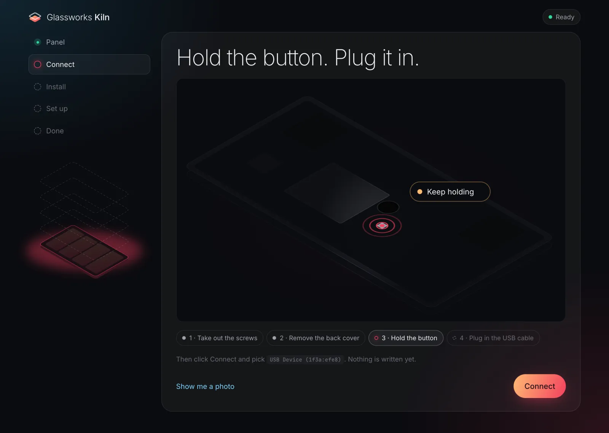
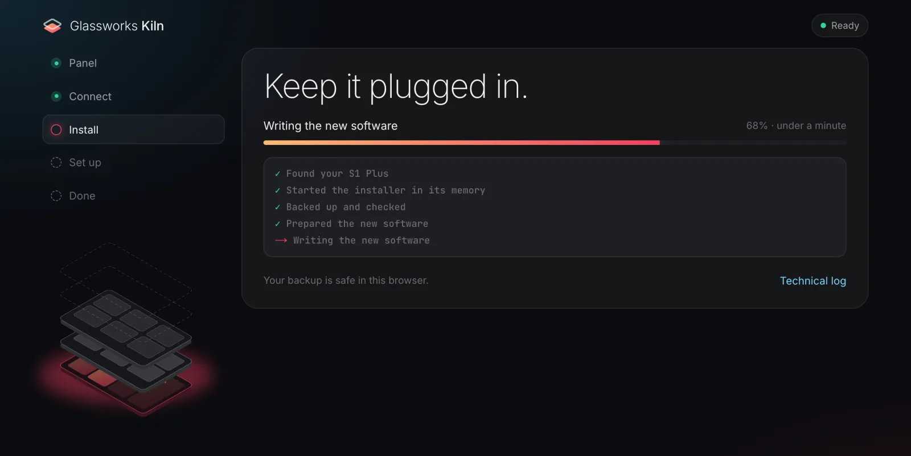
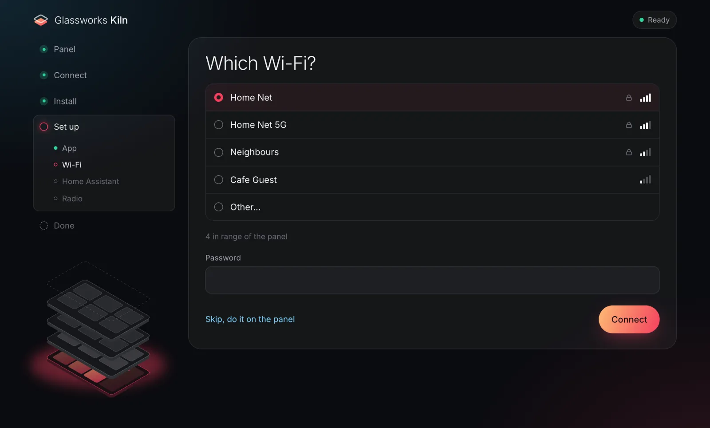
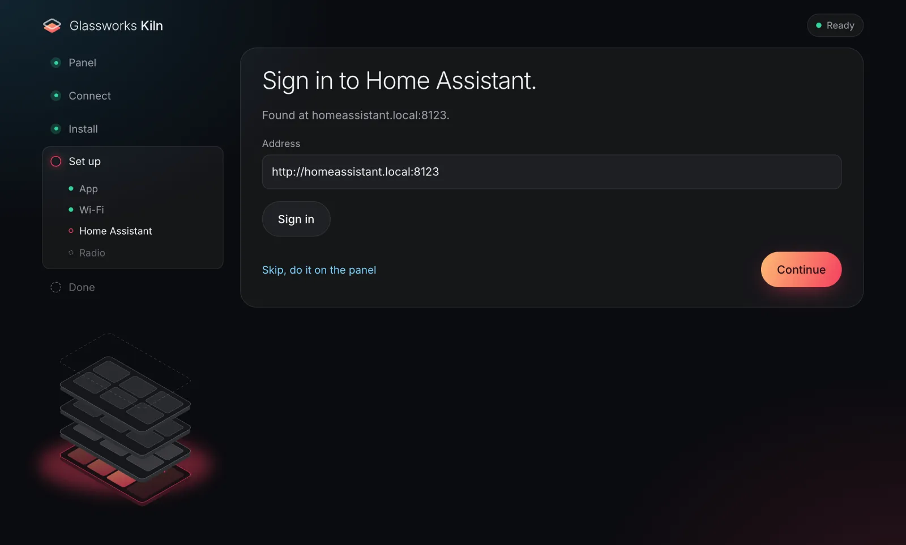

<p align="center">
  <a href="https://www.glassworks.dev/frames/aqara-s1-plus">
    <picture>
      <source media="(prefers-color-scheme: dark)" srcset="https://www.glassworks.dev/brand/banner-frame-aqara-s1-plus-on-dark.svg">
      
    </picture>
  </a>
</p>

<h1 align="center">Aqara S1 Plus</h1>

<p align="center">
  <b>Rooted Allwinner A133 wall panel and Glassworks' reference frame</b><br>
  Supports every pane matched to its hardware—including the built-in Zigbee/Thread radio and wall base relays (no camera hardware).
</p>

<p align="center">
  <a href="https://www.glassworks.dev">
    <picture>
      <source media="(prefers-color-scheme: dark)" srcset="https://www.glassworks.dev/brand/badge-on-dark.svg">
      
    </picture>
  </a>
  <a href="https://kiln.glassworks.dev/aqara-s1-plus">
    <picture>
      <source media="(prefers-color-scheme: dark)" srcset="https://www.glassworks.dev/brand/badge-kiln-on-dark.svg">
      
    </picture>
  </a>
  <picture>
    <source media="(prefers-color-scheme: dark)" srcset="https://www.glassworks.dev/brand/badge-status-stable-on-dark.svg">
    
  </picture>
  <a href="https://github.com/orgs/GlassworksHQ/projects/1">
    <picture>
      <source media="(prefers-color-scheme: dark)" srcset="https://www.glassworks.dev/brand/badge-roadmap-on-dark.svg">
      
    </picture>
  </a>
  <a href="https://www.glassworks.dev/frames/aqara-s1-plus">
    <picture>
      <source media="(prefers-color-scheme: dark)" srcset="https://www.glassworks.dev/frames/aqara-s1-plus/clarity-on-dark.svg">
      
    </picture>
  </a>
</p>

This folder defines the Glassworks **frame** for the Aqara Panel Hub S1 Plus. Its hardware metadata lives in [`design/frame.json`](design/frame.json) (see [frames/README.md](../README.md)) and is published at [glassworks.dev/frames/aqara-s1-plus](https://www.glassworks.dev/frames/aqara-s1-plus).

<p align="center">
  <a href="#install">Install</a> ·
  <a href="#what-you-get">Features</a> ·
  <a href="#status">Status</a> ·
  <a href="#the-radio">Radio</a> ·
  <a href="#updates">Updates</a> ·
  <a href="#known-issues">Known issues</a> ·
  <a href="#undo-and-safety">Undo &amp; safety</a> ·
  <a href="#faq">FAQ</a>
</p>

<p align="center">
  <a href="https://github.com/GlassworksHQ/glassworks/releases/latest"><b>Latest release</b></a> ·
  <a href="../../CHANGELOG.md">What's new</a> ·
  <a href="../../docs/research/README.md">How we got here</a>
</p>

## Credits

Kiln's installation workflow stands on two foundational open-source projects:

- **FEL recovery tooling:** [sunxi-tools](https://github.com/linux-sunxi/sunxi-tools) by [linux-sunxi](https://github.com/linux-sunxi) (GPL-2.0), which provides the FEL protocol reference used to boot U-Boot from RAM ([fel.md](research/fel.md), [web-installer.md](research/web-installer.md)).
- **Root access:** [Magisk](https://github.com/topjohnwu/Magisk) by [topjohnwu](https://github.com/topjohnwu) (GPL-3.0). Kiln downloads the official release directly and verifies its hash—Glassworks never bundles Magisk.

U-Boot, Trusted Firmware-A, and all other third-party components are documented in [THIRD-PARTY-NOTICES.md](../../THIRD-PARTY-NOTICES.md). Frame credits are declared in [`design/frame.json`](design/frame.json) ([format](../README.md#credits)).

## Why

The Aqara Panel Hub S1 Plus is great wall-mount hardware: a crisp 1440×720 touchscreen, microphone and speaker, time-of-flight presence sensor, ambient light sensor, Zigbee/Thread radio, and a mains relay wall base. Out of the box, however, it is locked to Aqara's launcher and cloud services, and its built-in Android WebView (Chromium 74) is far too old to run modern Home Assistant dashboards.

Glassworks replaces the software layer while leaving your hardware untouched. The panel boots straight into the open-source Glassworks app powered by GeckoView (Firefox's browser engine), displaying your Home Assistant dashboard full screen and exposing the panel as a single ESPHome device—with no Aqara account, no soldering, and no command-line tools required.

## What you get

**Your dashboard, full screen:** A modern Home Assistant frontend running as the panel's home screen with the header and sidebar hidden. Sign in by scanning a QR code with your phone so you never type passwords on the wall, and choose which dashboard to show from Home Assistant or the Manage page.

**Built-in Assist voice assistant:** On-device wake word detection (microWakeWord), Assist pipelines, on-screen voice timers, and spoken announcements with a calm full-screen overlay ([Voice and timers guide](../../docs/voice-and-timers.md)).

| Feature | What it gives you |
|---|---|
| 🏠 **Single ESPHome device** | Home Assistant discovers the panel automatically and configures encryption for you, exposing the screen light, presence, illuminance, speaker, voice controls, wall base, dashboard picker, and radio controls ([ESPHome entities](../../docs/esphome.md)). |
| 🎵 **Music Assistant player** | Native Sendspin player that streams synchronized multi-room audio alongside your other Sendspin speakers ([Sendspin guide](../../docs/sendspin.md)). |
| 🔔 **Rich notifications** | Show alerts from Home Assistant right over your dashboard with camera snapshots, action buttons, and chimes, or open a full-screen or half-screen doorbell view ([Notifications guide](../../docs/notifications.md)). |
| 👋 **Smart wake and dimming** | Wakes smoothly as you approach, sleeps when the room is empty, and adapts brightness to ambient light using the built-in sensors. Pair it with [Panel night mode](../../docs/blueprints.md) to dim at night ([Sensors guide](docs/sensors.md)). |
| 📡 **Local Zigbee/Thread radio** | Use the built-in Silicon Labs radio as a Zigbee coordinator (ZHA or experimental Zigbee2MQTT), a Thread border router, or a mesh repeater ([Radio guide](docs/radio-guide.md)). |
| 🔄 **One-click HA updates** | New Glassworks versions appear under *Settings → Updates* in Home Assistant and install hands-free, including radio helper updates ([Updates](#updates)). |
| 🔌 **Wall base relays** | Direct local UART driver for the mains relay base without Aqara's daemon—tested against an emulator, awaiting first run on a physical wall base ([Wall bases](research/bases.md)). |
| 🔒 **No Aqara cloud** | Disables Aqara's launcher, apps, updater, and cloud daemon reversibly. Normal operation stays local; the panel only contacts GitHub to download wake-word models on first use, check for Glassworks updates, or fetch the optional Silicon Labs Zigbee stack. |
| ✨ **Custom boot branding** | Displays the Glassworks splash and animated glass-tile boot sequence ([Boot branding](../../branding/glass-tile/README.md)). |

<p align="center">
  
</p>

## Status

**Status: stable.** It passes every case of Kiln's install contract, with none marked as failing, and installs from [kiln.glassworks.dev](https://kiln.glassworks.dev/aqara-s1-plus) on real panels.

**Clarity v1: D** — performs well as a wall panel for light Home Assistant dashboards. Typical dashboards hold it back from a C grade: without a live camera, the view draws in 0.9 seconds, but the main thread remains blocked for 2.7 seconds afterward. Home Assistant more-info dialogs settle in about 1 second on light dashboards and 1.2 to 1.4 seconds on typical dashboards, while heavy dashboards struggle with thermostat dialogs and sensor history graphs. See the full benchmark report in [clarity/report.md](clarity/report.md) and summary in [clarity/clarity.json](clarity/clarity.json) ([how Clarity grades](../../docs/perf.md)).

Here is where each feature stands today. ✅ means it has been checked on real panels, and 🧪 means it works but is still being tested or tuned.

| Feature | Status |
|---|---|
| Full-screen kiosk, Home Assistant dashboard, QR sign-in, dashboard picker | ✅ Works |
| ESPHome device with automatic encryption | ✅ Works |
| Voice assistant (on-device wake word, timers, announcements) | ✅ Works · far-field tuning ongoing |
| Music Assistant synchronized player (Sendspin) | ✅ Works |
| Notifications (cards, snapshots, buttons, sounds, full/half views) | ✅ Works · cards, buttons, Do not disturb, and full/half views checked on hardware; edge-case testing continues |
| Presence wake, idle screen-off, auto-brightness | ✅ Works |
| Night mode via Home Assistant ([Panel night mode](../../docs/blueprints.md)) | 🧪 Validated in Home Assistant; not yet run on a panel |
| Reversible Aqara cloud and bloat disabling | ✅ Works |
| Boot splash and animation | ✅ Works |
| Web installer (Kiln), CLI installer, and undo | ✅ Works · installs from [kiln.glassworks.dev](https://kiln.glassworks.dev/aqara-s1-plus) on real panels; boot patch tested on two stock firmware versions |
| Browser Manage page (`:8099`, HA sign-in, logs, diagnostics, multi-panel) | ✅ Works · ongoing polish |
| Vitro, the native dashboard renderer (*Settings → Labs*, [Try Vitro](../../docs/vitro.md)) | 🧪 Experimental · off by default; turns itself off if the app keeps crashing right after it starts |
| Network setup page (`:8099/setup`, 6-digit pairing code) | ✅ Works |
| Phone setup via temporary setup Wi-Fi | ✅ Works |
| Panel health diagnostics (CPU, temperature, RAM, storage, Wi-Fi, uptime) | ✅ Works |
| Bluetooth proxy (listen and active GATT connections) | 🧪 Scanning and single-device GATT checked on hardware; several devices connected at once is untested |
| Hands-free app updates from Home Assistant | ✅ Works from v0.4.1 onward ([one manual update](#updates) needed on older versions) |
| Frame version display and *Frame update* entity | ✅ Works · Install downloads the signed frame bundle, checks it, and restarts the panel once (checked on a panel with a test release). The first frame release comes with Glassworks 1.0 |
| Persistent time zone across reboots | ✅ Works (requires boot software from v0.4.0+) |
| Radio: Zigbee coordinator for **ZHA** | ✅ Verified (choose *keep the radio's network settings*; see [Known issues](#known-issues)) |
| Radio: Zigbee coordinator for **Zigbee2MQTT** | 🧪 Experimental · `ember` adapter forms networks and pairs devices; long-term soak testing ongoing |
| Radio: **Thread border router** | ✅ Works · verified standalone with Matter devices and alongside existing border routers (must share Home Assistant's network) |
| Radio: **Zigbee router** and **Thread router** repeaters | 🧪 Experimental · verified joining existing home networks |
| Radio firewall (Home Assistant only by default) | ✅ Verified |
| Radio firmware flashing | 🧪 Experimental · verified re-flashing Aqara's stock image; no third-party firmware offered yet |
| Wall base relays | 🧪 Driver verified against an emulator matching Aqara's `bracket_cli`; not yet tested on a physical wall base |
| Wi-Fi setup over Bluetooth (Improv) | 🧪 Implemented; lightly tested |
| Streamlined default HA entity list | 🧪 Checking upgrades on existing Home Assistant installs |

## Hardware

| Specification | Details |
|---|---|
| SoC | Allwinner A133 (quad-core Cortex-A53), 2 GiB DDR4, 8 GB eMMC |
| OS | Android 10 (32-bit userspace) |
| Dimensions | 172 × 86 mm; 42 mm deep with in-wall box |
| Display | 1440 × 720 capacitive touchscreen |
| Radio | Silicon Labs EFR32MG21 on SPI (RCP firmware) |
| Sensors | VI5300 time-of-flight presence sensor, MK6212 ambient light sensor |
| Audio | Built-in microphone and speaker |
| Extras | Wired mains relay wall base over UART |
| Root method | USB FEL recovery mode + patched boot image |

### Supported hardware

| Model | Support |
|---|---|
| **Aqara Panel Hub S1 Plus, MP-K03D** (wall-mounted; EU, UK, AU, and international regions) | ✅ Tested on firmware 4.5.80 |
| **Aqara S1 Plus China edition, JYMKP01LM** (86-box) | ✅ Community-reported working with Kiln (two panels running v0.4.3). Not directly tested by maintainers; Kiln refuses incompatible partition layouts before writing. |
| **S1 Plus Desktop, MP-K05D** | ❓ Untested |
| Other Aqara panels and hubs | ❌ Not supported |

## Install

Install Glassworks straight from your browser over USB-C using **[Kiln](https://kiln.glassworks.dev/aqara-s1-plus)**. Kiln backs up your panel's original partitions before modifying anything, patches the boot image safely in memory, and verifies every write. Full step-by-step instructions live in [docs/install.md](docs/install.md), and the frame's Kiln recipe lives in [`installer/`](installer/).

*(You can also sideload the app over adb without rooting, though radio modes require the root helper.)*

### What you need

- An **Aqara Panel Hub S1 Plus** ([supported hardware](#supported-hardware))
- A **USB-C data cable** plugged directly into your computer and a **small screwdriver** to remove the back cover once
- **Google Chrome or Microsoft Edge** on Windows, macOS, or Linux (WebUSB is not supported in Firefox or Safari)
- **Home Assistant** on the same network (2026.11 or newer recommended for automatic encryption)
- About **10 minutes**

### The web installer (recommended)

**[Open Kiln at kiln.glassworks.dev/aqara-s1-plus →](https://kiln.glassworks.dev/aqara-s1-plus)**

Kiln runs entirely inside your browser and uploads nothing to any server. It guides you through five clear steps:

1. **Panel:** Select **Aqara S1 Plus**.
2. **Connect:** Remove the back cover, hold the small FEL recovery button on the circuit board, and plug in USB-C. Windows needs a one-time Zadig WinUSB driver and Linux needs a udev rule; macOS needs no extra drivers.
3. **Install:** Kiln boots a temporary bootloader in RAM, backs up your panel's partitions inside your browser, patches `boot` (Magisk plus the S1 root helper), flashes it, and verifies every partition by reading it back.
4. **Set up:** Installs Glassworks as the panel's home screen with your language, time zone, and clock format, then walks you through Wi-Fi (sent directly over USB), Home Assistant sign-in, and your radio role.
5. **Done:** Download and safely store your backup `.zip` file. Home Assistant automatically discovers the panel as an ESPHome device—just click **Add**.

<table>
<tr>
<td width="50%"></td>
<td width="50%"></td>
</tr>
<tr>
<td width="50%"></td>
<td width="50%"></td>
</tr>
</table>

See **[docs/install.md](docs/install.md)** for per-OS driver setup, every screen walkthrough, undo instructions, and troubleshooting.

> [!NOTE]
> The installation has been verified end to end on real S1 Plus hardware (firmware 4.5.80) through Kiln, and the boot patch has been verified across two stock firmware versions. Glassworks has still run on a relatively small number of panels, so stop and [open an issue](https://github.com/GlassworksHQ/glassworks/issues) if anything looks unexpected—your backup remains safe.

### The command line

Prefer shell scripts or scripting? You can run the exact same workflow from macOS or Linux (requires `sunxi-fel`, `fastboot`, `adb`, Docker, and a U-Boot build):

```sh
frames/aqara-s1-plus/tools/install/fel-install.sh ~/s1-backup          # FEL → back up → patch → flash → verify
frames/aqara-s1-plus/tools/install.sh --url http://homeassistant.local:8123 \
    --timezone America/Los_Angeles --locale en-US # install and configure Glassworks over adb
```

See [Command line in docs/install.md](docs/install.md#command-line) for all options.

## The radio

Glassworks lets you assign the S1 Plus's built-in Silicon Labs EFR32 radio to one role at a time—either from **Settings → Radio** on the panel (with helpful phone QR codes for Home Assistant setup) or via **Radio mode** on the panel's Home Assistant device page:

- **Zigbee coordinator (ZHA):** Radio type `EZSP`, serial path `socket://<panel IP>:6638`.
- **Zigbee coordinator (Zigbee2MQTT, experimental):** Switch **Zigbee stack** to *Silicon Labs 8.2.2* first (downloaded automatically from Silicon Labs), then configure `adapter: ember` and `port: tcp://<panel IP>:6638`.
- **Thread border router:** Hosts a Thread network for Home Assistant's OpenThread Border Router integration.
- **Zigbee or Thread router (repeater, experimental):** Joins and extends your existing Zigbee or Thread mesh.

By default, only Home Assistant is allowed to connect to the radio ports. Read the [step-by-step radio guide](docs/radio-guide.md) or dive into the [technical radio reference](docs/radio.md).

## Updates

New Glassworks releases appear automatically in Home Assistant under **Settings → Updates** (**App update**). Click **Install** and the panel downloads, verifies its SHA-256 checksum and signing certificate, and installs hands-free with nothing to confirm on screen. See [Updates and restoring stock software](../../docs/updates.md) for the complete guide.

- **Panels on v0.4.0 or older:** Perform one manual update first (earlier versions failed Home Assistant installs with *"the APK is not signed"*). Open Kiln's [Finish setting up](https://kiln.glassworks.dev/aqara-s1-plus/set-up) flow or run `adb install -r` with the latest APK; from v0.4.1 onward, Home Assistant updates work automatically.
- **Radio helper updates:** Starting with v0.4.0, radio helper updates ship alongside app updates once your panel has the matching boot image. Check the **Radio helper** sensor in Home Assistant—if it asks for a boot image refresh, run a full Kiln install once more (keep the backup from your **first** install).
- **Switching from a development build to a release:** Because debug and release builds use different signing keys, moving to releases requires a one-time reinstall. Both Kiln and the CLI installer handle this safely and prompt you before making changes ([details](docs/install.md#switching-a-development-build-to-a-release)).

## Known issues

- **ZHA network creation and restore:** Creating a new Zigbee network or restoring a backup onto the panel hangs on older ZHA builds until upstream fix [zigpy/bellows#774](https://github.com/zigpy/bellows/pull/774) reaches Home Assistant. Choose **Keep the radio's network settings** during ZHA setup until then.
- **Zigbee2MQTT startup timing:** The Silicon Labs stack answers reset commands in ~4.3 seconds while Zigbee2MQTT waits 5 seconds. If a startup occasionally times out, restarting Zigbee2MQTT usually succeeds.
- **Zigbee2MQTT soak testing:** The Silicon Labs 8.2.2 stack has not yet had extended multi-device field testing.
- **Thread border router subnet:** The panel must sit on the same LAN/VLAN as Home Assistant (not an isolated IoT VLAN) so Home Assistant can route to Thread devices.
- **Switching from a debug build without adb root:** Replacing a debug build with a release build resets app settings unless adb has root access (see [Updates](#updates)).

## Undo and safety

- **Backups always come first:** Nothing is written until Kiln or the CLI saves a verified backup of your panel's partitions (as a `.zip` with `SHA256SUMS`). Keep the backup from your **first** install—it is the only copy of your original Aqara software.
- **Verified writes and hardware checks:** Every flashed partition is read back and compared byte for byte. Kiln also checks the SoC ID and partition layout before writing anything and stops if it sees unfamiliar hardware.
- **Minimal footprint:** Only `boot`, `vbmeta` flags, and the boot splash are modified. Android's `system` and `vendor` partitions are untouched, and Aqara's stock apps are disabled reversibly rather than deleted.
- **Built-in undo:** Open **Undo an install** in Kiln (or run `fel-install.sh --undo <backup-dir>` / `install.sh --undo`). Choose **As it came from Aqara** to restore the original partitions and factory reset, or **Keep its settings** to bring back Aqara's apps while preserving Wi-Fi.
- **Hard to brick:** FEL recovery mode lives in the A133 chip's read-only mask ROM and cannot be erased. As long as you have your original backup, you can always recover the panel.

> [!WARNING]
> Installing Glassworks modifies hardware you own at your own risk and may void your manufacturer warranty. Follow the installation steps carefully and always keep your first backup safe.

For scope, trademark, and licensing details, see [docs/legal.md](../../docs/legal.md).

## FAQ

<details>
<summary><b>Do I need to solder or use a serial console?</b></summary>

No. You only remove the back cover once to press a small button on the board while plugging in USB-C. A serial console was only needed during initial hardware research.
</details>

<details>
<summary><b>Can I go back to Aqara's stock software?</b></summary>

Yes. Use **Undo an install** in Kiln (or `fel-install.sh --undo`) to restore `boot`, `vbmeta`, and the boot splash from your first backup, then run a factory reset on the panel. See [Undo in docs/install.md](docs/install.md#undo).
</details>

<details>
<summary><b>Do I need an Aqara account or the Aqara app?</b></summary>

No. A brand-new panel that has never been paired with Aqara works right away. If your panel was previously set up with Aqara, it keeps its existing Wi-Fi credentials.
</details>

<details>
<summary><b>Will my existing Aqara Zigbee devices stay paired?</b></summary>

Not through Aqara's hub software, which Glassworks disables. Instead, you can run the panel's radio as a Zigbee coordinator for Home Assistant (ZHA or experimental Zigbee2MQTT) and pair your Zigbee devices directly to Home Assistant.
</details>

<details>
<summary><b>Does the panel still contact Aqara's cloud?</b></summary>

No. Glassworks stops Aqara's cloud daemon shortly after boot and disables Aqara's apps and updater. The panel only contacts GitHub to download wake word models on first use and to check for Glassworks updates roughly once a day (plus Silicon Labs' GitHub once if you opt into the Zigbee2MQTT stack). Everything else stays strictly on your local network.
</details>

<details>
<summary><b>Will Aqara firmware updates still install automatically?</b></summary>

No. Aqara's updater is disabled while Glassworks is installed. Undo the install first if you want stock updates again.
</details>

<details>
<summary><b>Why does Glassworks use GeckoView instead of Android's built-in browser?</b></summary>

The S1 Plus ships with Android 10's Chromium 74 WebView, which cannot render modern Home Assistant frontends. GeckoView bundles an up-to-date browser engine right inside the app.
</details>

<details>
<summary><b>Which Home Assistant version do I need?</b></summary>

Home Assistant **2026.11 or newer** is recommended because it provisions ESPHome encryption automatically, which also lets the radio firewall identify your Home Assistant server. Voice features require an Assist pipeline, and synced music requires Music Assistant with Sendspin.
</details>

<details>
<summary><b>How was the S1 Plus unlocked and brought up?</b></summary>

Everything from FEL recovery and mainline U-Boot DRAM fixes to byte-exact browser boot patching, radio bring-up, and the wall base UART protocol is documented in **[How we got here](../../docs/research/README.md)**.
</details>

## Panes

| Pane | Support | Notes |
|---|---|---|
| Assist | Stable | On-device wake word and Home Assistant Assist satellite |
| Timers | Stable | On-screen voice timers and chimes |
| Sendspin | Stable | Synchronized Music Assistant player |
| Zigbee / Thread radio | Stable | Zigbee coordinator/repeater and Thread border router/repeater |
| Time zone | Stable | Automatically supported; persists time zone across reboots |
| Diagnostics | Stable | System and app health sensors |
| Bluetooth proxy | Stable | Passive BLE scanning and active GATT connections (single-device GATT verified; concurrent links untested) |
| Notifications | Stable | Rich alerts, snapshots, buttons, and dashboard views |
| Camera | Not supported | The S1 Plus does not have a built-in camera |
| Wall base | Alpha | Verified against emulator matching Aqara's `bracket_cli`; awaiting physical base test ([base-protocol.md](research/base-protocol.md), [bases.md](research/bases.md)) |

Panes without an explicit override in `frame.json` derive their compatibility automatically from the frame's declared hardware capabilities ([how it works](../README.md#the-panes-a-frame-runs)).

## Research notes

Detailed engineering notes for the Aqara S1 Plus ([see all research notes](../../docs/research/README.md#the-research-notes)):

- [hardware.md](research/hardware.md): Board teardown, SoC, FEL button, and 3-pin UART console setup
- [boot-log.md](research/boot-log.md): Annotated stock boot log, BOOT0 DRAM bring-up, secure boot, and partitions
- [findings.md](research/findings.md): Root, SELinux, AVB, partitions, USB/adb defaults, and why buttonless USB entry is unavailable
- [fel.md](research/fel.md): Mainline U-Boot over FEL, A133 DDR4 fix, CPU clocking, chunked uploads, and fastboot
- [root.md](research/root.md): Persistent Magisk root, root helper threat model, first-boot adb provisioning, and `fel-install.sh`
- [web-installer.md](research/web-installer.md): WebUSB installer design spec (FEL, fastboot, byte-exact boot patching, per-OS setup)
- [screen-policy.md](research/screen-policy.md): Investigating Aqara's stock night Do Not Disturb rule and replacing it
- [debloat.md](research/debloat.md): Aqara package inventory, reversible de-bloating, and cloud daemon Wi-Fi watchdog
- [bases.md](research/bases.md): Wall base variants, communication path, and kiosk driver architecture
- [base-protocol.md](research/base-protocol.md): Wall base UART protocol specification and emulator proof against `bracket_cli`
- [zigbee2mqtt.md](research/zigbee2mqtt.md): Running Silicon Labs `zigbeed` 8.2.2 on Aqara's RCP firmware
- [rcp-firmware.md](research/rcp-firmware.md): Feasibility study for building newer multiprotocol RCP firmware on EFR32MG21
- [framework-restart.md](research/framework-restart.md): Android 10 ActivityManager failure during rapid kiosk restarts
- [boot-animation.md](research/boot-animation.md): Android 10 boot animation constraints, texture caching, and boot partition budget
- [idle-cpu.md](research/idle-cpu.md): Idle CPU profiling of wake word inference and per-thread breakdown
- [bluetooth.md](research/bluetooth.md): RTL8821CS Bluetooth coexistence, Android 10 scan rules, and ESPHome GATT proxy behavior
- [view-open.md](research/view-open.md): Profiling Home Assistant dashboard view-open latency on GeckoView at 1.5 GHz
- [install-crash-loop.md](research/install-crash-loop.md): Android 10 ActivityManager LRU bug after force-stops and framework watchdog recovery
- [frame-loader.md](research/frame-loader.md): Frame loader architecture, fixed service slots, frame bundles, and over-the-air frame updates

## Files

- [`design/frame.json`](design/frame.json): Catalog metadata, 3D model definition, and boot branding target
- [`design/recovery.json`](design/recovery.json): Data-driven recovery-mode animation steps
- [`installer/`](installer/): Kiln WebUSB installation recipe
- [`research/`](research/): Hardware bring-up and engineering notes listed above
