# Install Glassworks on the Aqara S1 Plus

There are two ways to install, and they do the same thing. **Kiln**, the web installer, runs in
your browser and needs nothing else. The **command line** runs the same steps as shell scripts,
for scripting or if you'd rather not use WebUSB. Both back up the panel first and both can undo.

- [Before you start](#before-you-start)
- [Install with Kiln](#install-with-kiln)
- [When something fails](#when-something-fails)
- [Undo](#undo)
- [Updating](#updating)
- [Command line](#command-line)
- [Switching a development build to a release](#switching-a-development-build-to-a-release)
- [Time zone](#time-zone)
- [Troubleshooting](#troubleshooting)

> [!NOTE]
> The old S1 installer runs the same recipe as Kiln. It has been tested end to end on a real
> S1 Plus (firmware 4.5.80), from FEL mode through the backup, the install and the app setup, and
> so has the command line. **Kiln itself has not yet done a full install on a real panel.** The
> boot patch has been tested on two firmware versions: 4.5.80 and the December 2025 firmware the
> panel shipped with. So far that is a small number of panels. If anything looks wrong, stop and
> [open an issue](https://github.com/GlassworksHQ/glassworks/issues). Your backup is safe.

## Before you start

- **Panel:** Aqara Panel Hub S1 Plus (MP-K03D). See [supported hardware](../README.md#supported-hardware).
- **Cable:** a USB-C **data** cable. Many charging cables carry no data. Plug it straight into the
  computer, not through a hub or dock.
- **Tool:** a small screwdriver to open the back cover. You need to reach one button on the board.
- **Computer:** Chrome or Edge on Windows, macOS or Linux (WebUSB). Firefox and Safari don't
  support WebUSB. If they can't, Kiln says *Use Chrome or Edge* instead of its first screen.
- **Home Assistant** on the same network, with the ESPHome integration available (it's built in).
  2026.11 or newer is recommended: it sets up the panel's encryption by itself.
- About **10 minutes**.

<a id="1--check-this-browser"></a>

### One-time setup for your computer

| OS | What to do |
|---|---|
| **macOS** | Nothing. If you use `adb`, run `adb kill-server` first, because only one program can hold the panel. |
| **Windows** | Once: with the panel in FEL mode, open [Zadig](https://zadig.akeo.ie/), choose *Options → List all devices*, pick `USB Device (1f3a:efe8)`, select **WinUSB** and click *Replace driver*. Kiln's own USB mode installs its driver by itself. |
| **Linux** | Once: save the rule below as `/etc/udev/rules.d/50-s1.rules` and run `sudo udevadm control --reload`. Stop `adb` if it is running (`adb kill-server`). |

```
SUBSYSTEM=="usb", ATTR{idVendor}=="1f3a", ATTR{idProduct}=="efe8", MODE="0660", TAG+="uaccess"
SUBSYSTEM=="usb", ATTR{idVendor}=="1f3a", ATTR{idProduct}=="1010", MODE="0660", TAG+="uaccess"
```

Kiln's Connect screen reminds you of this step on Windows and Linux. Its **How** link points here.

### Finding the FEL button

FEL is the A133's USB recovery mode; Kiln calls it **recovery mode**. It lives in the chip's mask
ROM, so it is always there and it doesn't care what is on the eMMC. With the back cover off, the
button is a small tactile switch to the right of the shield can's notch, just below the round
sensor window. It is not the reset button on the case.


To enter FEL: unplug the panel, **hold the button, plug in USB-C**, then let go. It enters FEL as
soon as it has power, within about two seconds. The screen stays black. That's expected.

## Install with Kiln

Open **[Kiln](https://kiln.glassworks.dev/aqara-s1-plus)** in Chrome or Edge. Nothing is uploaded
anywhere: the page talks to the panel over USB and keeps its backup in the browser.

The rail on the left shows where you are: **Panel → Connect → Install → Set up → Done**. Each
step has its own address, so you can bookmark or reload one:

| Address (after `kiln.glassworks.dev`) | What it does |
|---|---|
| `/` | Pick your panel |
| `/aqara-s1-plus` | A full install: starts at Connect, with the panel in FEL mode |
| `/aqara-s1-plus/set-up` | **Finish setting up** an installed panel: connects to it over USB (no FEL, nothing reflashed), updates Glassworks with your settings, then Wi-Fi, Home Assistant and radio |
| `/aqara-s1-plus/set-up/wifi` | Just the Wi-Fi step, on an installed panel |
| `/aqara-s1-plus/set-up/home-assistant` | Just the Home Assistant step |
| `/aqara-s1-plus/set-up/radio` | Just the Zigbee/Thread radio role |
| `/aqara-s1-plus/undo` | **Undo an install**: put the original software back |

The old installer's addresses still work at the end of Kiln's: `#/resume`, `#/wifi`,
`#/home-assistant`, `#/radio`, `#/undo` and `#/install` go to the matching step. While Kiln is
working, a step's address shows that step. Going to another one doesn't stop it, and the picker
offers **Back to it**.

### 1 · Panel


*Pick **Aqara S1 Plus**, then **Continue**. The two links at the bottom are for a panel that is
already installed.*

### 2 · Connect

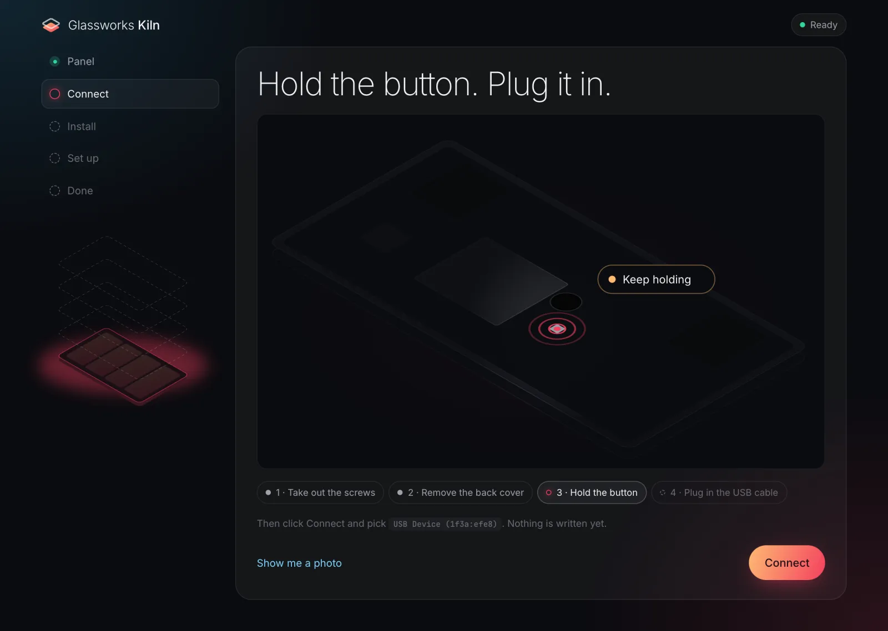

*The animation is the instruction. **Show me a photo** opens the board photo above.*

1. Put the panel in FEL mode as described [above](#finding-the-fel-button).
2. Click **Connect** and pick `USB Device (1f3a:efe8)` in the browser's list.

Kiln checks that the chip is an A133 with secure boot off before it does anything else. If the
list is empty, or the device won't open, see [Troubleshooting](#troubleshooting).

### 3 · Install

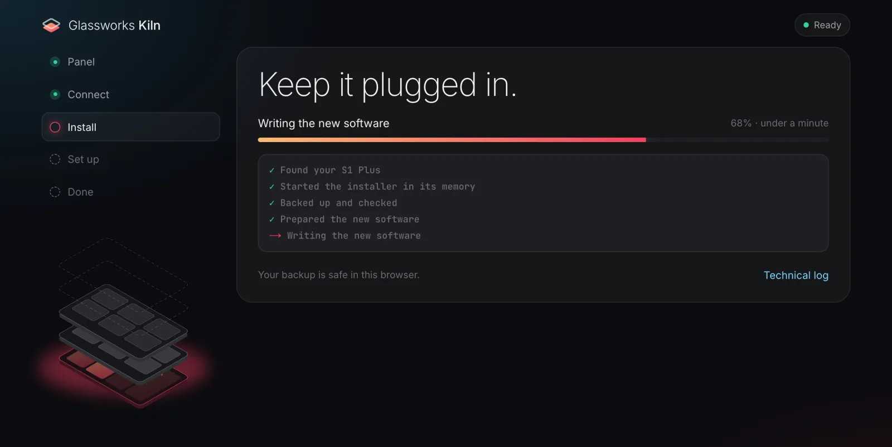

*Keep the cable in and the page open. **Technical log** shows each partition with its size and hash.*

Kiln:

1. starts its own U-Boot **from RAM**, so nothing is written yet, and checks that the partition
   layout is an S1 Plus;
2. **backs up** `boot`, `vbmeta` and the other small partitions, reading `boot` twice and comparing.
   The backup is stored in this browser. From here on the screen says *Your backup is safe in this
   browser*;
3. **patches** `boot` in the browser: Magisk v31.1, the S1 root helper, the boot animation, and
   this browser's adb key for the first boot. The result is byte for byte what the CLI's
   Docker-based patch produces;
4. sets the `vbmeta` flags to "verification off" if they aren't already, and swaps in the Glass
   Tile splash;
5. **flashes** each partition and **reads it back** to check it, then restarts the panel.

Twice during this step the browser needs a click from you, because WebUSB opens a new device only
from a click. Kiln shows a **Your turn** sheet each time:

<table>
<tr>
<td width="50%"></td>
<td width="50%">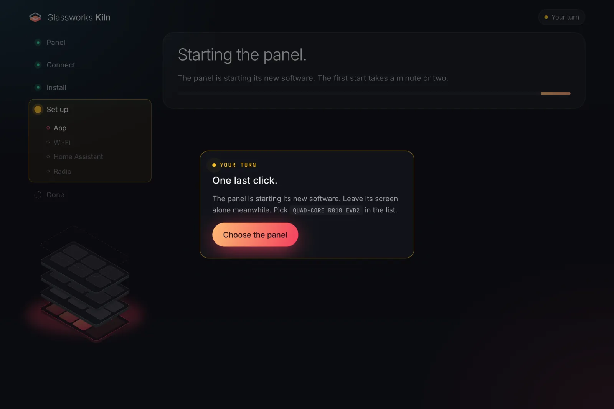</td>
</tr>
<tr>
<td><em>After U-Boot starts: click <b>Choose the panel</b> and pick <code>USB download gadget</code>.</em></td>
<td><em>After the restart: pick <code>QUAD-CORE R818 EVB2</code>. The first start takes a minute or two.</em></td>
</tr>
</table>

If you close the browser's list without picking, the sheet says so. Click the button again.

### 4 · Set up

Glassworks goes on the panel and becomes its home screen. Then Wi-Fi, Home Assistant and the radio,
from the same page. The rail shows these four as **App, Wi-Fi, Home Assistant, Radio**, and you
can go back to any of them.

**App.** Language, time zone, 12- or 24-hour clock, and an on-screen keyboard (Simple Keyboard,
Apache-2.0) instead of Aqara's. They start as this computer's. Click **Install Glassworks**. It takes
about a minute.

<table>
<tr>
<td width="50%"></td>
<td width="50%">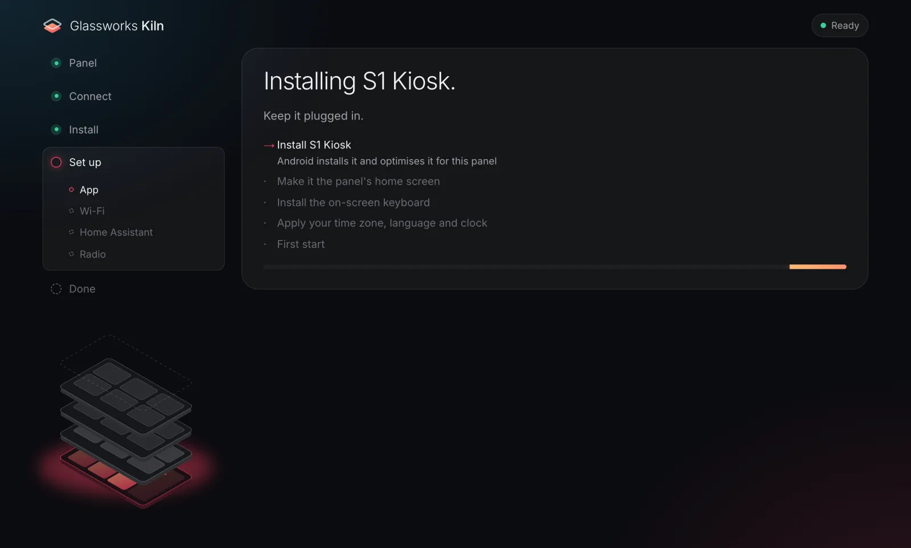</td>
</tr>
<tr>
<td><em>The settings. On an installed panel the heading says <b>Update Glassworks</b>.</em></td>
<td><em>The app going in. On an update, the app on the panel closes and restarts during this. That's expected.</em></td>
</tr>
</table>

The time zone is kept from then on. Aqara's software would reset it at every boot: see
[Time zone](#time-zone).

**Wi-Fi.** The list is what the panel can see. Pick a network, type its password and click
**Connect**. The password goes straight to the panel over USB and isn't stored on your computer. A
panel that is already on Wi-Fi shows *Connected to …*: click **Continue** to keep it, or **Use
another network**.

<table>
<tr>
<td width="50%">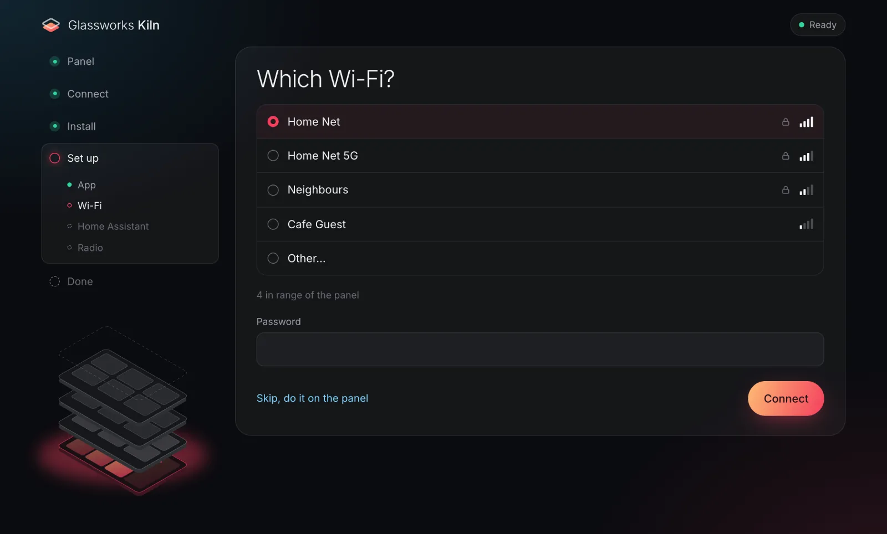</td>
<td width="50%">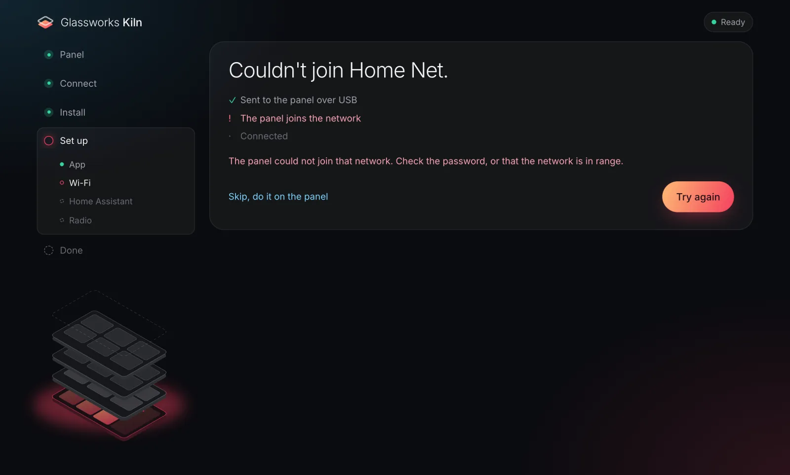</td>
</tr>
<tr>
<td><em>Pick a network. <b>Other…</b> lets you type a name that isn't listed.</em></td>
<td><em>A wrong password or a network out of range. <b>Try again</b>, or skip.</em></td>
</tr>
</table>

**Home Assistant.** Kiln shows the address the panel found on your network, or asks you to type
it. **Sign in** opens Home Assistant's sign-in in a small window, through the panel, so your login
goes from Home Assistant straight to the panel. When you are signed in, the window closes and Kiln
moves on to the radio by itself. (A browser that blocks pop-ups gets a tab instead; it ends on
"Signed in. Kiln has moved on.")

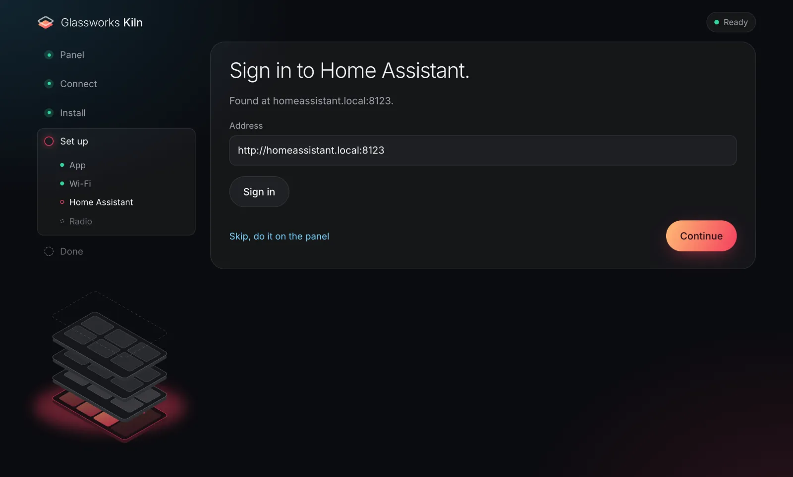

*Home Assistant also finds the panel by itself. Click **Add** on the discovered panel in
Settings → Devices & services.*

**Radio.** Choose what the Zigbee/Thread radio does, then **Finish**. It starts as *Off*. You can
change it any time in Home Assistant.

<table>
<tr>
<td width="50%">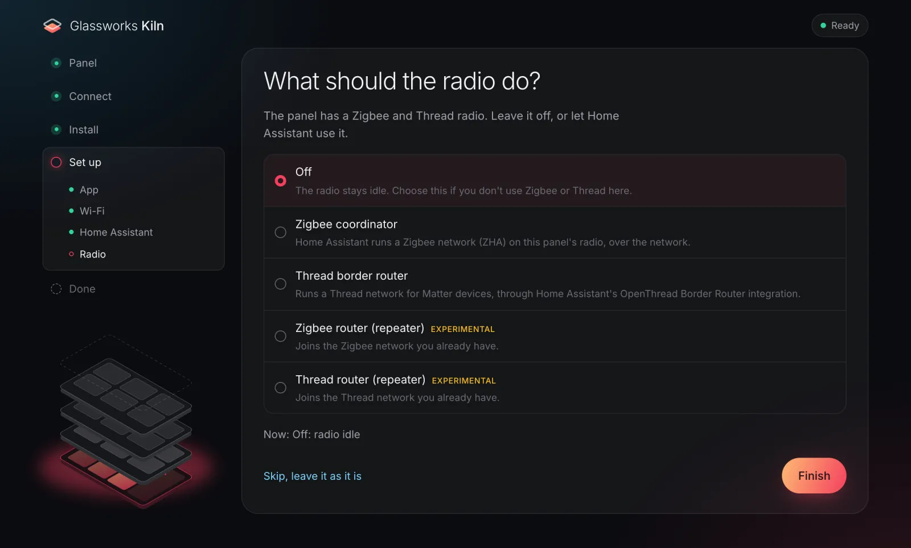</td>
<td width="50%">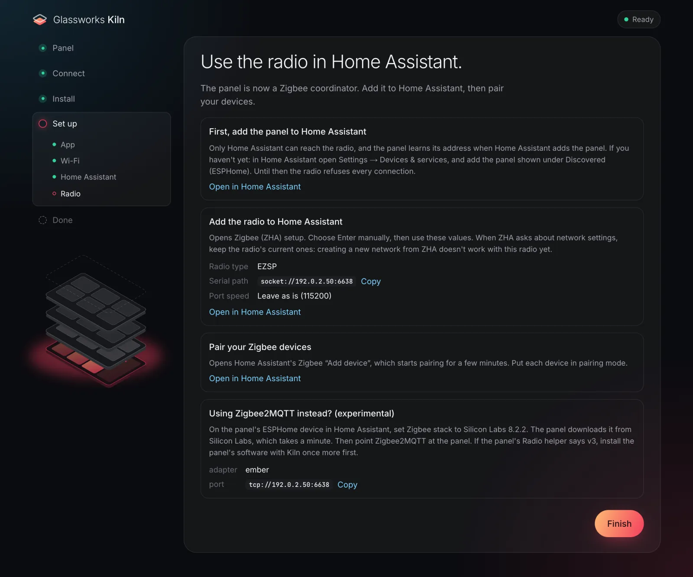</td>
</tr>
<tr>
<td><em>The choice.</em></td>
<td><em>What to do next in Home Assistant for the mode you chose, with links that open the right pages and values to copy.</em></td>
</tr>
</table>

| Radio mode | Status |
|---|---|
| Off | Default. The radio stays idle. |
| Zigbee coordinator | Home Assistant runs a Zigbee network on the panel's radio, over the network: ZHA, or Zigbee2MQTT (**experimental**). |
| Thread border router | Runs its own Thread network for Home Assistant's OpenThread Border Router integration. Must be on Home Assistant's network. |
| Zigbee router (repeater), Thread router (repeater) | **Experimental.** Joins the network you already have and extends it. |

More on each mode: [radio-guide.md](radio-guide.md).

Wi-Fi, Home Assistant and the radio can each be skipped (*Skip, do it on the panel*) and done
later on the panel itself. Its setup screen covers Wi-Fi (including Improv over Bluetooth), adding
it to Home Assistant, and QR sign-in. See [onboarding.md](../../../docs/onboarding.md).


*Setting up Wi-Fi on the panel instead: it asks before it accepts Wi-Fi details over Bluetooth.*

### 5 · Done


*Click **Download** and keep the `.zip`.*

**Download the backup and keep it.** The backup from your first install is the only copy of the
panel's original software. The `.zip` holds each partition and a `SHA256SUMS` file. It is also kept
in this browser, but clearing the browser's site data deletes that copy. If the panel already had
our software, the row says the backup isn't the original: keep the one from your first install.

Home Assistant discovers the panel as an ESPHome device and sets up encryption by itself.
What you get in HA: [esphome.md](../../../docs/esphome.md). Music Assistant pairs with the panel automatically:
[sendspin.md](../../../docs/sendspin.md).

## When something fails

Kiln stops and says three things: what happened, whether anything was written, and the most likely
fix. **More help** has tips, the error message, the technical log, and the way to undo.

<table>
<tr>
<td width="50%"></td>
<td width="50%"></td>
</tr>
<tr>
<td><em><b>Nothing was written</b>: the panel is as it was. Fix the cause and click <b>Try again</b>.</em></td>
<td><em><b>Part of the new software was written</b>: use <b>Undo with your backup</b>, or try again. Unplug it only to put it in recovery mode again.</em></td>
</tr>
</table>

"Don't unplug it yet" means: not while Kiln is still writing, and not to leave it like this,
because the panel may not start. Once Kiln has stopped, unplug it, then hold the button and plug it
back in to enter recovery mode, as on the Connect screen. Undo connects to it there. FEL is in the
chip's ROM, so you can always get back to recovery mode, whatever was written. If a
failure came after the new software was in place (during Set up), nothing more can break:
unplug the panel, plug it back in, and use **Finish setting up**. The titles Kiln uses are in
[Troubleshooting](#troubleshooting).

## Undo

Open **Undo an install** from Kiln's first screen, or **Undo** on the Done screen. The rail shows
**Backup → Connect → Restore → Done**.

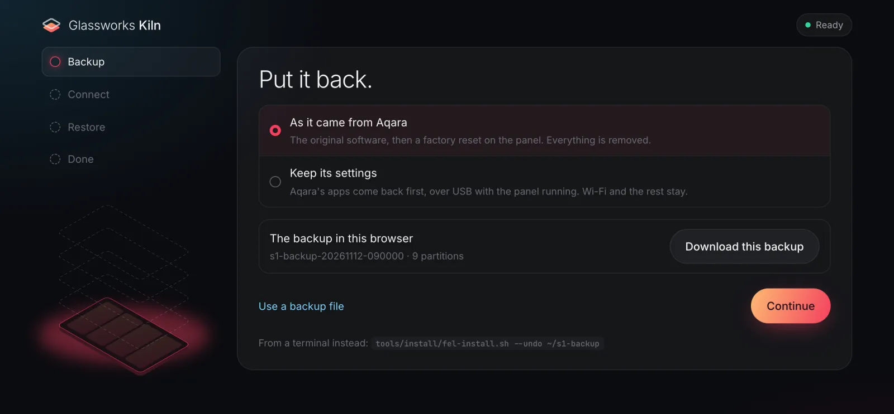

*Choose how far back, and which backup. Kiln uses the backup in this browser, or **Use a backup
file** for the `.zip`.*

1. **Choose how far back.**
   - **As it came from Aqara**: the original software, then a factory reset on the panel.
     Everything is removed.
   - **Keep its settings**: first, with the panel running and plugged in, **Give back Aqara's
     apps** brings back Aqara's apps, launcher, keyboard, Do Not Disturb and radio services over
     USB, and takes Glassworks off (pick `QUAD-CORE R818 EVB2` in the list). Wi-Fi and the rest
     stay. Then the original software goes back too.
2. **Check the backup.** Kiln checks it before anything changes on the panel. It refuses a backup
   that can't undo the install, and then changes nothing: see [which backup](#which-backup) below.
3. **Connect.** Click **Continue**, put the panel in FEL mode, and pick `USB Device (1f3a:efe8)`,
   as on the install's Connect screen.
4. **Restore.** Kiln writes `boot`, `vbmeta` and the splash partition back from the backup, and
   reads each one back to check it.

<table>
<tr>
<td width="50%"></td>
<td width="50%">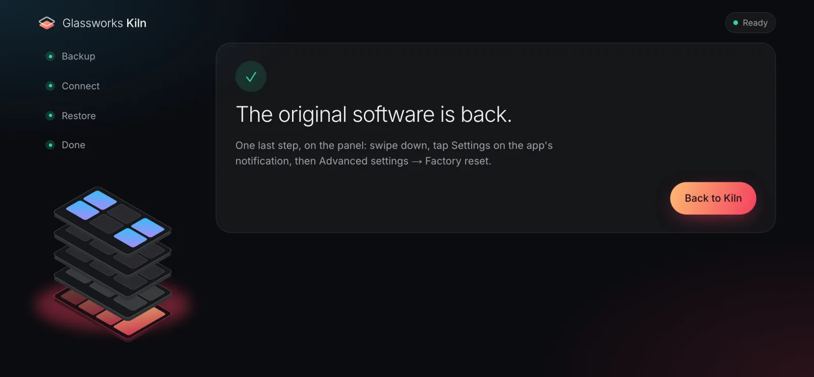</td>
</tr>
<tr>
<td><em>Restore. Keep it plugged in.</em></td>
<td><em>Done, for <b>As it came from Aqara</b>: the factory reset is the last step.</em></td>
</tr>
</table>

5. **Factory reset the panel**, if you chose *As it came from Aqara*. On the panel, swipe down from
   the top, tap *Settings* on the app's notification (*Glassworks*, or *S1 Kiosk* up to 0.4.3), then *Advanced settings → Factory reset*.
   A factory reset alone doesn't restore the software, so restore first. With *Keep its settings*
   the panel restarts with Aqara's software and apps, and your settings and Wi-Fi as they were.

From the CLI: `frames/aqara-s1-plus/tools/install/fel-install.sh --undo ~/s1-backup` restores the software, and
`frames/aqara-s1-plus/tools/install.sh --undo` over adb gives Aqara's apps back. It re-enables Aqara's apps and
launcher, restores Do Not Disturb and the keyboard, removes Glassworks, and starts Aqara's radio
services again. Run on its own, without the restore, it keeps your Wi-Fi and settings and the
patched `boot`, but drops the kiosk. Its last line says what happened to Glassworks: removed,
disabled, or still installed when Android would not disable it either. Then it exits with an error;
run it again.

If Glassworks saved the panel's Wi-Fi (it does when you set Wi-Fi up through it), or the installer
can't tell who saved it, it is **disabled rather than removed**. Android 10 forgets the networks an app saved when that app is uninstalled,
which would take the panel off its network. A disabled Glassworks doesn't run and isn't the home
screen; `adb shell pm enable sh.edm.s1kiosk` brings it back. To remove it completely anyway, run
`adb uninstall sh.edm.s1kiosk`, then join the Wi-Fi again in Aqara's own settings.

### Which backup

Use the backup from your **first** install. A backup taken on an already-installed panel holds the
patched `boot`, and both installers refuse to restore it. They also refuse a backup whose splash is
already ours, not Aqara's. That happens when `boot` was put back without its splash (by hand, as
below), and the panel was then installed again: that second backup has a stock `boot` but our splash.
Use the older backup, from the first install. If you no longer have it, put back only `boot` and
`vbmeta` by hand, as below. The splash then stays ours. It is only the power-on image, so the panel
works the same.

Keep the whole backup: the `.zip` Kiln offers, or the CLI's folder. Undo needs `boot.img`,
`vbmeta.img`, `bootloader.img` (the splash) and `SHA256SUMS`, and refuses a backup that lacks one of
them, before it writes anything. Kiln then says *This backup can't undo the install* and links to
the steps below. If you only have `boot.img` and `vbmeta.img`, you can still put those
two back by hand. The splash then stays ours. The same goes for a backup refused because its splash
is ours.

Do this only with a backup whose `boot` and `vbmeta` are both Aqara's: one made at your first
install, or one refused only because its splash is ours and taken after both `boot` and `vbmeta` were
put back. A backup taken after only `boot` was put back, or after an install that stopped between
writing `vbmeta` and `boot`, holds our `vbmeta`, with verification off. A backup made on an
already-installed panel holds our patched `boot`. Putting either back by hand leaves our software in
place of Aqara's. The check below shows that the two files are intact, not that they are Aqara's.

First check those two, in the backup's folder. It needs both entries in `SHA256SUMS` and both files
to match. Go on only if it ends with `boot and vbmeta OK: go on`:

<!-- install-tests.sh runs this block: keep the marker right above it -->
```sh
grep -q '  boot\.img$' SHA256SUMS && grep -q '  vbmeta\.img$' SHA256SUMS &&
  grep -E '  (boot|vbmeta)\.img$' SHA256SUMS | shasum -a 256 -c - &&
  echo "boot and vbmeta OK: go on"
```

This needs what the [command line](#command-line) needs: macOS or Linux (not Windows), a checkout of
this repository, and its U-Boot build. Then put the panel in FEL mode and run this from the
repository's folder, with `B` set to the backup's folder. Each command runs only if the one before it worked, so a failed flash stops
before the restart. If a flash fails, the panel stays in our U-Boot's fastboot: run that
`fastboot flash` line again, then the rest.

```sh
B=~/s1-backup                                 # the backup's folder
unset ANDROID_SERIAL                          # our U-Boot's fastboot serial isn't the panel's adb one
NO_BL31=1 frames/aqara-s1-plus/tools/fel/fel-boot.sh &&            # our U-Boot in RAM; it starts fastboot
  fastboot flash boot "$B/boot.img" &&
  fastboot flash vbmeta "$B/vbmeta.img" &&
  fastboot reboot
```

## Updating

**Glassworks updates through Home Assistant.** A new release shows up under *Settings → Updates* as
the panel's **App update**. Press **Install**; the panel downloads it, checks its checksum and
signing key, installs it and restarts the app. There's nothing to confirm on the panel (on boot
software from before the first releases, Android asks on the panel's screen). Details:
[esphome.md](../../../docs/esphome.md#app-updates).

- **On v0.4.0 or older, update by hand once.** Those versions can't install an update from Home
  Assistant: it always fails with "the APK is not signed". Plug the panel in, open Kiln, choose
  **Finish setting up** (`/aqara-s1-plus/set-up`) and let it update Glassworks. Or download the APK
  from the [latest release](https://github.com/GlassworksHQ/glassworks/releases/latest) and run
  `adb install -r s1-kiosk-<version>.apk`. From v0.4.1 on, updates from Home Assistant work.
- **The boot software** (the patched `boot` with the root helper) is not updated by the app. Since
  v0.4.0 the radio side updates with the app instead, but only on a panel with that version's boot
  software. Home Assistant's **Radio helper** sensor says whether it needs updating. To update it,
  run the full install again from Kiln's start (`/aqara-s1-plus`), with the FEL button. It backs up
  again first, but keep the backup from your **first** install: it's the only one with Aqara's
  original `boot`.
- A panel running a **development build** can't take release updates. See
  [the section below](#switching-a-development-build-to-a-release).

## Command line

Use this path to script the install, or if you don't want to use WebUSB. It runs on macOS or
Linux and needs `sunxi-fel`, `fastboot`, `adb`, Docker (for the boot patch) and a U-Boot build.

```sh
# 0. Build U-Boot for the panel (once) and the kiosk app
UBOOT_SRC=~/src/u-boot BL31=<bl31.bin> frames/aqara-s1-plus/tools/fel/build-uboot.sh
./gradlew :kiosk:assembleDebug

# 1. FEL → boot U-Boot from RAM → back up → patch → vbmeta → splash → flash → verify → adb
frames/aqara-s1-plus/tools/install/fel-install.sh ~/s1-backup

# 2. Install and configure Glassworks over adb
frames/aqara-s1-plus/tools/install.sh --url http://homeassistant.local:8123 \
    --timezone America/Los_Angeles --locale en-US \
    --keyboard rkr.simplekeyboard.inputmethod_149.apk     # optional, from F-Droid
```

- `fel-install.sh` waits for FEL (hold the button, plug in), then backs up to `~/s1-backup` with
  a `SHA256SUMS` file. Opt out of the branding with `BRANDING=none` and `BOOT_ANIMATION=none`.
- `install.sh` installs the app, grants its permissions, makes it the home screen, disables
  Aqara's bloat and night screen-off, and pushes the wake word models. `--dry-run` prints what
  it would do. `--help` lists every option.
- Already have adb on a panel? `frames/aqara-s1-plus/tools/install.sh` alone sets up the app without root. You only
  get the radio modes with the root helper from `fel-install.sh`.
- Undo from the CLI: see [Undo](#undo).

How each step works, and why: [frames/aqara-s1-plus/research/root.md](../research/root.md) and [frames/aqara-s1-plus/research/fel.md](../research/fel.md).

## Switching a development build to a release

A panel set up with the command line usually runs a **development build** of Glassworks
(`assembleDebug`, signed with your computer's debug key). Releases are signed with the project's
key, and Android won't update an app to one signed with a different key. So the switch removes
the app and installs the release. On its own, that has two side effects:

- the app's data goes: its settings, the Home Assistant sign-in and the pairing key;
- Android 10 also forgets every Wi-Fi network the app saved. Glassworks saves the panel's Wi-Fi itself
  (Improv), so the panel would drop off the network.

Both installers handle this. Install as usual (Kiln's **Finish setting up**, or `frames/aqara-s1-plus/tools/install.sh
--apk <release APK>`). When Android refuses the new version, nothing has been changed yet. The
installer then says what will happen on this panel and asks you to confirm: a dialog in the browser,
or typing `yes` in the terminal (`--switch` confirms in advance, for scripts). `--dry-run` shows the
plan without changing anything.

| | adb has root | adb has no root (a normal install) |
|---|---|---|
| App settings, sign-in, pairing key | Kept: copied out before the removal, then copied back to the new install | **Reset**: sign in again, and set the panel's options again (dashboard, screen and voice settings, for example). Home Assistant may ask to add the panel again, and Music Assistant shows it as a new player |
| Wi-Fi | Read from Android's Wi-Fi store into Kiln's or the CLI's memory, then sent to the new app over USB | Kiln: the Wi-Fi step asks for the password. CLI: asks in the terminal (Enter skips) |

- **Root** here means that adb's shell can run `su`. That is only the case with a development boot
  image (`DEV_SU_HOURS`) or a Magisk policy for the adb shell, see
  [frames/aqara-s1-plus/research/root.md](../research/root.md#persistent-root-magisk--the-s1-kiosk-root-helper). A normal
  install doesn't give adb root. The installer checks with `su -c id`.
- The Wi-Fi password is never written to a file, a log or the screen. A network that Glassworks didn't
  save, for example one set up in Aqara's settings, is not affected.
- While the app is copied it is disabled, so it can't start as the home screen meanwhile. Disabling
  doesn't touch its Wi-Fi.
- If the new version won't install, the previous one is put back (with its data, given root). If
  its data won't go back in, the installer says so and keeps the copy on the panel in
  `/data/s1kiosk/switch` (root only).
- The panel stays reachable over the USB cable throughout. If it ends up without Wi-Fi anyway, send
  it again: Kiln's `/aqara-s1-plus/set-up/wifi`, or Improv over Bluetooth from the panel's setup
  screen or Home Assistant.

## Time zone

Aqara's system software sets the time zone again at every boot. Its own (cloud-side) setting is empty
on a panel without Aqara's cloud, so it falls back to UTC+8 and picks the first zone with that offset,
`Antarctica/Casey`. The panel's root helper (boot image with helper v4) puts the zone you chose back
within seconds after boot, and whenever it changes later.

- The installer records your choice (`persist.s1kiosk.timezone`) along with setting it.
- To change it later: the panel's ESPHome device in Home Assistant, Configuration, **Time zone**: an id
  like `Europe/Berlin` or `America/New_York`. HA adds it turned off, so turn it on first
  ([how](../../../docs/esphome.md#categories-and-defaults)). It only accepts zones the panel knows, and only from Home
  Assistant's encrypted connection. **Time zone status** (Diagnostic) says whether the zone is being
  kept.
- Panels set up before this: on their first boot with the new helper it keeps the zone that is in place
  then, unless that is Aqara's `Antarctica/Casey`; then set **Time zone** once.
- With an older boot image the reset still happens; Time zone status says so.

## Troubleshooting

| Symptom | What to try |
|---|---|
| *Use Chrome or Edge* or *Open this page over https* instead of Kiln's first screen | This browser has no WebUSB. Use Chrome or Edge on a computer. |
| The browser lists no `1f3a:efe8` device, or Kiln says *No panel in recovery mode* | The panel isn't in FEL. Unplug it, hold the board button (not the case button), plug in, and hold for 10 s. Try another cable or port, preferably directly on the computer rather than through a hub. |
| Windows: the device shows but won't open | The Zadig step: `1f3a:efe8` needs **WinUSB**. |
| Linux: "access denied" | The udev rule, then unplug and replug. |
| *Another program has the panel*, or `adb` already holds it | Run `adb kill-server` and close other flashing tools. |
| *It disconnected*, or *The USB connection isn't reliable* | A cable straight into the computer, not through a hub or dock. Then Try again. |
| *This isn't a panel Kiln knows* | Kiln stopped before writing anything. That panel isn't a layout it knows; please [open an issue](https://github.com/GlassworksHQ/glassworks/issues). |
| *This panel only runs signed software* | Its chip has secure boot on, so Kiln can't start on it. Nothing was written. |
| *A download failed* | Check the computer's internet connection, then try again. Kiln checks every file it downloads by its SHA-256. |
| *Something went wrong while writing*, or a read-back didn't match | Kiln stops and doesn't restart the panel, which may not start now. Don't unplug it while Kiln is writing. Once it has stopped, unplug it, put it in recovery mode again (hold the button, plug in) and use *Undo with your backup*, or try again. FEL is always available. |
| *The panel didn't finish starting* | Unplug it and plug it back in, then use **Finish setting up**. |
| *This backup can't undo the install* | See [Which backup](#which-backup). Nothing on the panel was changed. |
| Signing in stops after a few seconds with *Home Assistant didn't say who signed in*, but the dashboard works | Home Assistant's name probably resolves to an IPv6 address the panel can't reach (`ping6 homeassistant.local` fails, `ping` works). Update the app: newer versions try every address, as a browser does ([Signing in](../../../docs/manage.md#signing-in)). Or use Home Assistant's IPv4 address as its address. |
| The screen turns off at night | The panel has no night mode of its own since #473: check for an automation in Home Assistant that sets its *Idle timeout*, such as one from the [Panel night mode](../../../docs/blueprints.md) blueprint. With `install.sh --keep-dnd`, Aqara's own Do Not Disturb (22:00–07:00) also forces it off; see [frames/aqara-s1-plus/research/screen-policy.md](../research/screen-policy.md). |
