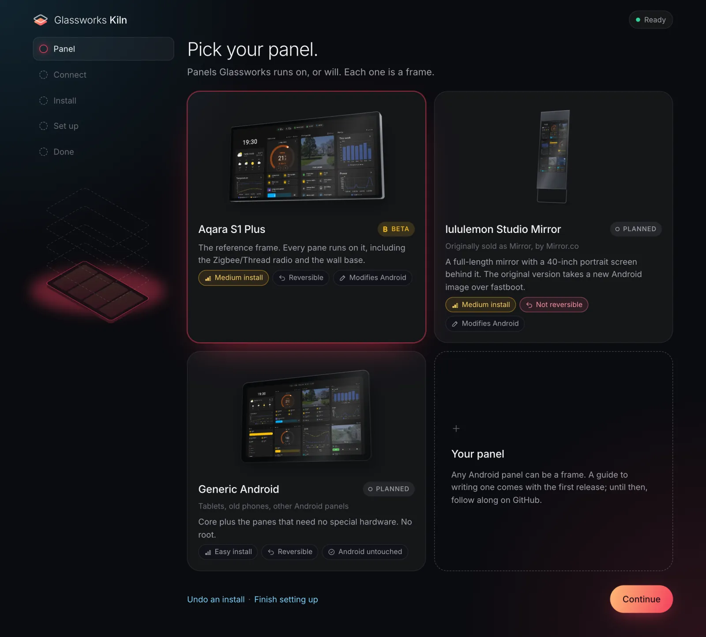
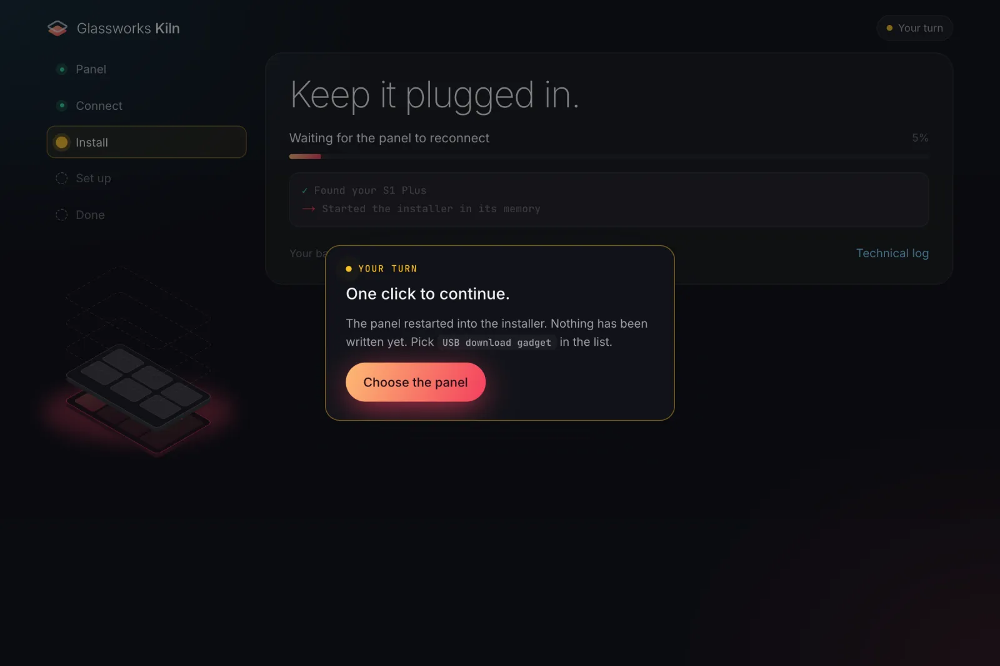
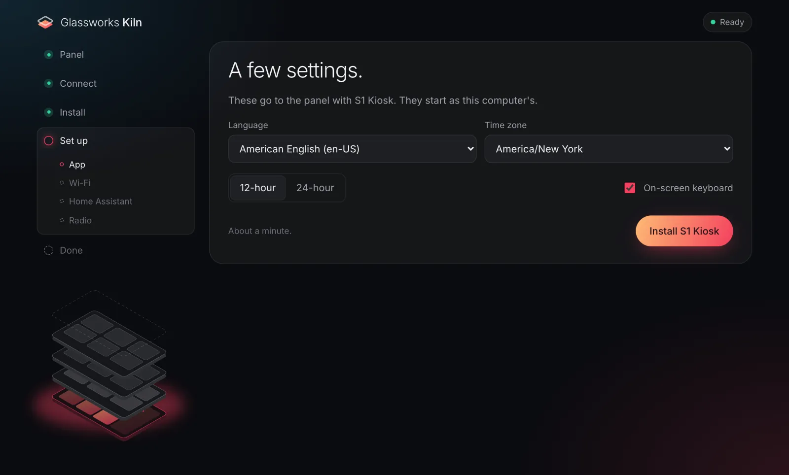
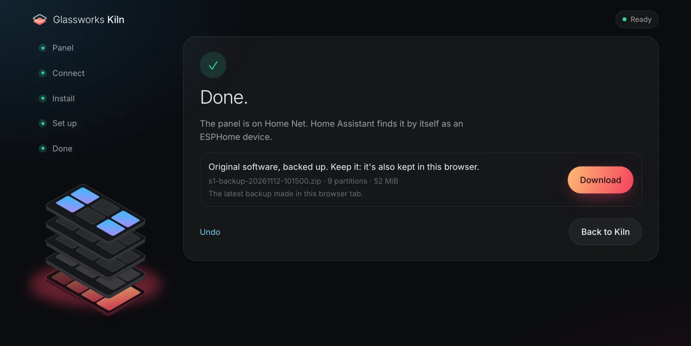
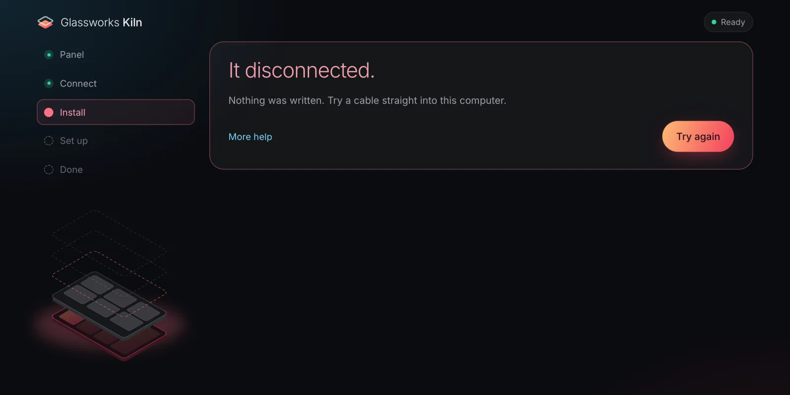
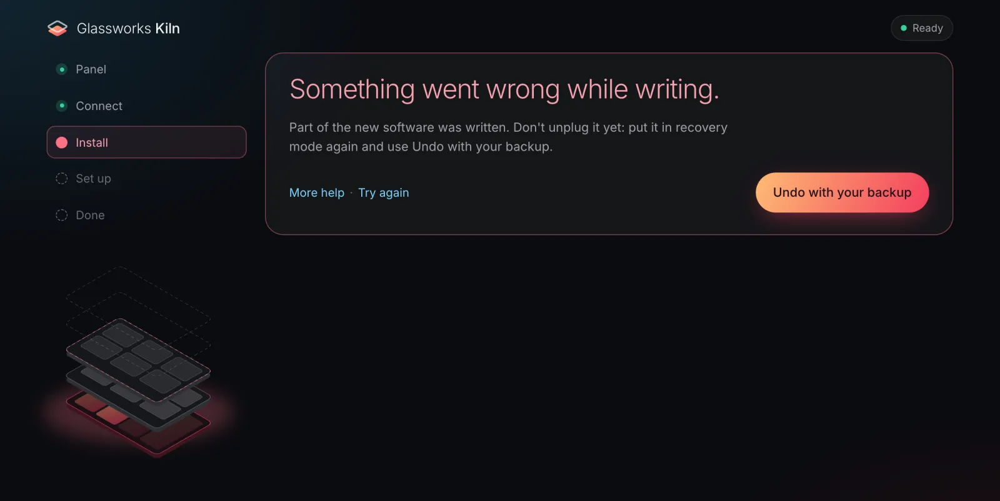
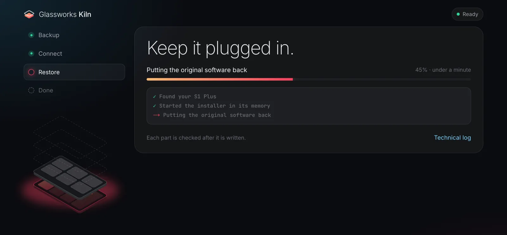

# Install Glassworks on the Aqara S1 Plus

You can install Glassworks on the Aqara Panel Hub S1 Plus in two ways: using **Kiln**, our browser-based installer that requires no command-line tools, or via our **command-line scripts** if you prefer working in a terminal. Both methods follow the same safe sequence—backing up your panel's original partitions first, verifying every write, and giving you a reliable undo path.

- [Before you start](#before-you-start)
- [Install with Kiln](#install-with-kiln)
- [When something fails](#when-something-fails)
- [Undo](#undo)
- [Updating](#updating)
- [Command line](#command-line)
- [Switching a development build to a release](#switching-a-development-build-to-a-release)
- [Time zone](#time-zone)
- [Troubleshooting](#troubleshooting)

> [!NOTE]
> The S1 Plus installation recipe has been verified end to end on real hardware (firmware 4.5.80), through Kiln at kiln.glassworks.dev as well as the command-line scripts, and the boot patch has been verified across two firmware versions (4.5.80 and the December 2025 factory image). If anything looks unexpected at any point, stop and [open an issue](https://github.com/GlassworksHQ/glassworks/issues)—your backup remains safe.

## Before you start

- **Panel:** Aqara Panel Hub S1 Plus (MP-K03D). See [supported hardware](../README.md#supported-hardware).
- **Cable:** A reliable **USB-C data cable** plugged directly into your computer rather than through a USB hub or dock (many charge-only cables cannot carry data).
- **Tool:** A small screwdriver to remove the back cover once so you can reach the recovery button on the circuit board.
- **Browser:** **Google Chrome or Microsoft Edge** on Windows, macOS, or Linux. Kiln relies on WebUSB, which Firefox and Safari do not support.
- **Home Assistant:** Running on the same local network with the built-in ESPHome integration. **Home Assistant 2026.11 or newer** is recommended so encryption is configured automatically.
- **Time:** About **10 minutes**.

<a id="1--check-this-browser"></a>

### One-time setup for your computer

| Operating system | One-time preparation |
|---|---|
| **macOS** | None. If you have `adb` installed, run `adb kill-server` first so nothing else holds the USB connection. |
| **Windows** | With the panel in FEL recovery mode, open [Zadig](https://zadig.akeo.ie/), enable *Options → List all devices*, select `USB Device (1f3a:efe8)`, pick **WinUSB**, and click **Replace driver**. Kiln's subsequent USB modes install their drivers automatically. |
| **Linux** | Save the udev rules below to `/etc/udev/rules.d/50-s1.rules`, run `sudo udevadm control --reload`, and stop `adb` if running (`adb kill-server`). |

```
SUBSYSTEM=="usb", ATTR{idVendor}=="1f3a", ATTR{idProduct}=="efe8", MODE="0660", TAG+="uaccess"
SUBSYSTEM=="usb", ATTR{idVendor}=="1f3a", ATTR{idProduct}=="1010", MODE="0660", TAG+="uaccess"
```

Kiln's Connect screen also reminds you of these OS steps and links directly back here.

### Finding the FEL button

FEL is the Allwinner A133 chip's built-in USB recovery mode (Kiln calls it **recovery mode**). Because it resides in the chip's read-only mask ROM, it is always reachable regardless of what is stored on flash memory.

With the back cover removed, locate the tiny tactile switch just to the right of the metal shield notch, below the round sensor window. Make sure you press this board switch and **not** the external reset button on the plastic case.


To enter FEL mode: unplug the panel, **hold the board button down, plug in the USB-C cable**, and release after two seconds. The screen stays completely black—that is normal.

## Install with Kiln

Open **[Kiln](https://kiln.glassworks.dev/aqara-s1-plus)** in Chrome or Edge. Everything runs locally in your browser: Kiln talks directly to your panel over USB and keeps your backup right in your browser until you download it.

The left navigation rail tracks your progress through **Panel → Connect → Install → Set up → Done**. Each step has its own direct URL if you want to jump straight to a specific task later:

| URL path (on `kiln.glassworks.dev`) | Purpose |
|---|---|
| `/` | Choose your device |
| `/aqara-s1-plus` | Full installation starting at Connect (FEL mode) |
| `/aqara-s1-plus/set-up` | **Finish setting up** an already-installed panel over USB (no FEL or reflashing): updates Glassworks and configures Wi-Fi, Home Assistant, and radio |
| `/aqara-s1-plus/set-up/wifi` | Update Wi-Fi only on an installed panel |
| `/aqara-s1-plus/set-up/home-assistant` | Configure Home Assistant sign-in only |
| `/aqara-s1-plus/set-up/radio` | Change the Zigbee/Thread radio role only |
| `/aqara-s1-plus/undo` | **Undo an install** and restore Aqara's original software |

Legacy hash URLs from the original S1 installer (`#/resume`, `#/wifi`, `#/home-assistant`, `#/radio`, `#/undo`, `#/install`) automatically redirect to the corresponding Kiln step.

### 1 · Panel



*Select **Aqara S1 Plus** and click **Continue**. Use the bottom links if you are undoing or resuming setup on a panel that already has Glassworks.*

### 2 · Connect


*Follow the animation (or click **Show me a photo** for the board view above).*

1. Put the panel into FEL recovery mode as described [above](#finding-the-fel-button).
2. Click **Connect** and select `USB Device (1f3a:efe8)` from your browser's device picker.

Kiln verifies that the chip is an Allwinner A133 with secure boot disabled before proceeding. If no device appears or the connection fails, jump to [Troubleshooting](#troubleshooting).

### 3 · Install


*Keep the USB cable connected and the browser tab open. Expand **Technical log** anytime to see partition sizes and SHA-256 hashes.*

During this stage, Kiln automatically:

1. Boots a temporary U-Boot image **in RAM** (writing nothing to flash yet) and verifies that the partition layout matches an S1 Plus.
2. **Backs up** `boot`, `vbmeta`, and the panel's other small partitions—reading `boot` twice to verify consistency—and saves the archive in your browser (*"Your backup is safe in this browser"*).
3. **Patches** `boot` directly inside your browser with Magisk v31.1, the S1 root helper, the Glassworks boot animation, and a first-boot adb key (producing output byte-identical to our Docker CLI patch).
4. Updates `vbmeta` verification flags if needed and installs the Glassworks boot splash.
5. **Flashes** each modified partition, **reads it back** to verify every byte, and reboots the panel.

Because WebUSB requires a user click whenever a device reconnects under a new USB identity, Kiln pauses twice with a **Your turn** prompt:

<table>
<tr>
<td width="50%"></td>
<td width="50%"></td>
</tr>
<tr>
<td><em>After U-Boot starts in RAM: click <b>Choose the panel</b> and select <code>USB download gadget</code>.</em></td>
<td><em>After the panel reboots: select <code>QUAD-CORE R818 EVB2</code>. First boot takes one to two minutes.</em></td>
</tr>
</table>

If you accidentally close the browser prompt without picking a device, just click the button again.

### 4 · Set up

Next, Kiln installs the Glassworks app as the panel's home screen and walks you through **App**, **Wi-Fi**, **Home Assistant**, and **Radio**—you can step back to any of these sections from the left rail.

**App:** Confirm your language, time zone, 12- or 24-hour clock format, and whether to include the optional open-source keyboard (Simple Keyboard, Apache-2.0) in place of Aqara's. All values default to your computer's current settings. Click **Install Glassworks** and wait about a minute.

<table>
<tr>
<td width="50%"></td>
<td width="50%"></td>
</tr>
<tr>
<td><em>Confirm your regional preferences. On an already-installed panel, this screen reads <b>Update Glassworks</b>.</em></td>
<td><em>Installing and configuring Glassworks. During an update, the app closes and restarts briefly.</em></td>
</tr>
</table>

Your chosen time zone is preserved automatically across reboots (see [Time zone](#time-zone)).

**Wi-Fi:** Pick your Wi-Fi network from the list scanned by the panel, enter your password, and click **Connect**. Your Wi-Fi password travels directly to the panel over USB and is never saved on your computer. If the panel is already connected to Wi-Fi, click **Continue** to keep it or **Use another network** to switch.

<table>
<tr>
<td width="50%"></td>
<td width="50%"></td>
</tr>
<tr>
<td><em>Select your network, or choose <b>Other…</b> for a hidden SSID.</em></td>
<td><em>If joining fails, double-check the password or signal strength and click <b>Try again</b>.</em></td>
</tr>
</table>

**Home Assistant:** Confirm the Home Assistant server discovered on your network (or type its URL manually) and click **Sign in**. Home Assistant's login page opens in a pop-up window proxied through the panel so your credentials go directly from Home Assistant to the panel; once signed in, the window closes and Kiln advances automatically. *(If your browser blocks pop-ups, it opens a regular tab instead.)*


*Don't forget to also click **Add** on the discovered ESPHome device inside Home Assistant under **Settings → Devices & services**.*

**Radio:** Choose how you want to use the panel's built-in Zigbee/Thread radio and click **Finish**. It defaults to **Off**, and you can change roles anytime later from the panel or Home Assistant.

<table>
<tr>
<td width="50%"></td>
<td width="50%"></td>
</tr>
<tr>
<td><em>Select your preferred radio role.</em></td>
<td><em>Tailored Home Assistant next steps with direct links and one-click copy buttons.</em></td>
</tr>
</table>

| Radio mode | Description |
|---|---|
| **Off** (default) | Leaves the radio idle. |
| **Zigbee coordinator** | Hosts a Zigbee network over your LAN for ZHA, or for Zigbee2MQTT (**experimental**). |
| **Thread border router** | Runs a Thread network for Home Assistant's OpenThread Border Router integration (must share Home Assistant's network). |
| **Zigbee router / Thread router (repeater)** | **Experimental.** Joins and extends your existing Zigbee or Thread network. |

See [radio-guide.md](radio-guide.md) for detailed configuration steps for each role.

You can skip Wi-Fi, Home Assistant, or Radio during Kiln setup (*Skip, do it on the panel*) and finish them later right on the panel—including Wi-Fi via Bluetooth Improv or phone hotspot, and QR sign-in ([onboarding.md](../../../docs/onboarding.md)).


*When configuring Wi-Fi over Bluetooth on the panel, you must approve the request on screen first.*

### 5 · Done



*Click **Download** and store your backup `.zip` somewhere safe.*

**Keep the backup from your first install.** That `.zip` file (containing your original partitions and a `SHA256SUMS` manifest) is the only copy of your panel's factory software. Although Kiln also stores a copy inside your browser, clearing browser site data will erase it. If you re-run Kiln on a panel that already has Glassworks installed, Kiln reminds you that the new snapshot is not the original factory backup—always hold onto your very first backup.

Home Assistant automatically discovers the panel as an ESPHome device and configures encryption. Explore what you can control in [esphome.md](../../../docs/esphome.md), [voice-and-timers.md](../../../docs/voice-and-timers.md), and [sendspin.md](../../../docs/sendspin.md).

## When something fails

If an error occurs, Kiln pauses and clearly states three things: what happened, whether anything was written to flash, and the recommended recovery step. Click **More help** for detailed guidance, the technical log, and undo options.

<table>
<tr>
<td width="50%"></td>
<td width="50%"></td>
</tr>
<tr>
<td><em><b>Nothing was written:</b> your panel is untouched. Fix the cable or driver issue and click <b>Try again</b>.</em></td>
<td><em><b>Part of the new software was written:</b> once Kiln stops, re-enter FEL mode and use <b>Undo with your backup</b> (or retry).</em></td>
</tr>
</table>

Never unplug the panel while Kiln is actively flashing. Once Kiln has stopped, unplug the cable, hold the FEL board button while plugging it back in, and run **Undo with your backup**. Because FEL lives in the chip's read-only ROM, you can always re-enter recovery mode no matter what happened during flashing. If an error happens later during **Set up**, your boot software is already safely installed—simply reboot the panel and use **Finish setting up**.

## Undo

Open **Undo an install** from Kiln's home screen (or **Undo** on the Done screen). The left rail walks through **Backup → Connect → Restore → Done**.


*Choose how far back to restore and select your browser backup or click **Use a backup file** to load your `.zip`.*

1. **Choose a restore mode:**
   - **As it came from Aqara:** Restores your original `boot`, `vbmeta`, and boot splash partitions, followed by a factory reset on the panel to remove Glassworks and all settings completely.
   - **Keep its settings:** First connects over USB while Android is running (**Give back Aqara's apps**, selecting `QUAD-CORE R818 EVB2`) to re-enable Aqara's apps, launcher, keyboard, Do Not Disturb, and radio services while keeping your Wi-Fi configuration, then restores the original partitions.
2. **Verify backup integrity:** Kiln validates your backup before modifying anything on the panel and refuses any backup that cannot safely restore stock software (see [Which backup](#which-backup)).
3. **Connect in FEL mode:** Click **Continue**, hold the FEL button while plugging in USB-C, and select `USB Device (1f3a:efe8)`.
4. **Restore:** Kiln writes `boot`, `vbmeta`, and the original splash partition back and verifies each one by reading it back.

<table>
<tr>
<td width="50%"></td>
<td width="50%"></td>
</tr>
<tr>
<td><em>Restoring and verifying original partitions.</em></td>
<td><em>After <b>As it came from Aqara</b> finishes, complete the factory reset on the panel.</em></td>
</tr>
</table>

5. **Factory reset (for *As it came from Aqara* only):** Swipe down from the top of the panel, tap **Settings** on the Glassworks notification (labeled *S1 Kiosk* on v0.4.3 and older), and choose **Advanced settings → Factory reset**. Always restore partitions with Kiln *before* factory resetting—a factory reset alone does not replace the boot partition.

**From the command line:** Run `frames/aqara-s1-plus/tools/install/fel-install.sh --undo ~/s1-backup` to restore the original partitions, and `frames/aqara-s1-plus/tools/install.sh --undo` over adb to re-enable Aqara's apps and remove Glassworks.

> [!NOTE]
> If Glassworks saved the panel's Wi-Fi credentials—or the installer cannot verify which app saved them—undo **disables** Glassworks instead of uninstalling it. Android 10 deletes any Wi-Fi networks saved by an app when that app is uninstalled, which would knock the panel offline. A disabled Glassworks app does not run and is no longer the home screen (`adb shell pm enable sh.edm.s1kiosk` re-enables it). If you want to uninstall it completely, run `adb uninstall sh.edm.s1kiosk` and reconnect Wi-Fi through Aqara's settings.

### Which backup

Always use the backup archive created during your **first** installation. Both Kiln and the CLI refuse to restore a backup taken from an already-patched panel (or a backup whose splash partition already contains the Glassworks splash, which can happen if only `boot` and `vbmeta` were restored manually earlier).

Keep the complete archive containing `boot.img`, `vbmeta.img`, `bootloader.img` (the splash), and `SHA256SUMS`. If Kiln reports *This backup can't undo the install* because you only still have stock `boot.img` and `vbmeta.img` (or a backup whose splash is already ours), you can restore just `boot` and `vbmeta` manually—the panel will work normally, simply keeping the Glassworks power-on image.

Only run this manual restore with a backup whose `boot.img` and `vbmeta.img` are genuinely Aqara's stock partitions. First verify both checksums inside your backup folder and proceed only if the command prints `boot and vbmeta OK: go on`:

<!-- install-tests.sh runs this block: keep the marker right above it -->
```sh
grep -q '  boot\.img$' SHA256SUMS && grep -q '  vbmeta\.img$' SHA256SUMS &&
  grep -E '  (boot|vbmeta)\.img$' SHA256SUMS | shasum -a 256 -c - &&
  echo "boot and vbmeta OK: go on"
```

Next, return to the root of your repository checkout (for example, `cd /path/to/glassworks`) on macOS or Linux with the U-Boot build ready (see [Command line](#command-line)), put the panel into FEL mode, and flash both partitions:

```sh
cd /path/to/glassworks                        # return to the repo root first
B=~/s1-backup                                 # your backup folder
unset ANDROID_SERIAL                          # U-Boot's fastboot serial differs from Android's adb serial
NO_BL31=1 frames/aqara-s1-plus/tools/fel/fel-boot.sh &&            # boot U-Boot in RAM into fastboot
  fastboot flash boot "$B/boot.img" &&
  fastboot flash vbmeta "$B/vbmeta.img" &&
  fastboot reboot
```

Each step runs only if the previous command succeeded. If a flash fails, the panel remains in U-Boot's fastboot mode so you can re-run that `fastboot flash` line and continue.

## Updating

Glassworks updates right from Home Assistant under **Settings → Updates** (**App update**). Click **Install**, and the panel downloads, checks the SHA-256 checksum and signing certificate, installs silently, and restarts. See [Updates and restoring stock software](../../../docs/updates.md) for the full guide.

- **Panels on v0.4.0 or older:** Update once manually first (versions up to 0.4.0 rejected Home Assistant installs with *"the APK is not signed"*). Plug into USB, open Kiln's [Finish setting up](https://kiln.glassworks.dev/aqara-s1-plus/set-up), or download the [latest release APK](https://github.com/GlassworksHQ/glassworks/releases/latest) and run `adb install -r s1-kiosk-<version>.apk`. From v0.4.1 onward, Home Assistant updates work automatically.
- **Panels on v0.4.4 showing no root helper or an "unknown apps" dialog:** Panels installed with Kiln right before v0.9.0 received the newer Glassworks boot software alongside the v0.4.4 app, which only checks the older service names. Update the app once over USB using Kiln's [Finish setting up](https://kiln.glassworks.dev/aqara-s1-plus/set-up) or `adb install -r s1-kiosk-<version>.apk` (using the 32-bit `s1-kiosk-<version>.apk` asset, not `arm64-v8a`). No recovery mode or boot reflash is needed, your settings stay intact, and future Home Assistant updates install silently.
- **Boot software updates:** Starting with v0.4.0, radio helper fixes update automatically alongside the app once your boot image supports them. Check Home Assistant's **Radio helper** sensor to see if your boot image needs refreshing; if so, run a full Kiln install once more (keeping the backup `.zip` from your **first** install).
- **Development builds:** Local debug builds cannot update directly to official releases because their signing keys differ (see [below](#switching-a-development-build-to-a-release)).

## Command line

For scripted installs or environments without WebUSB, run the CLI tools on macOS or Linux (requires `sunxi-fel`, `fastboot`, `adb`, Docker for the boot patch, and a U-Boot build):

```sh
# 0. Build U-Boot for the panel (once) and the kiosk app
UBOOT_SRC=~/src/u-boot BL31=<bl31.bin> frames/aqara-s1-plus/tools/fel/build-uboot.sh
./gradlew :kiosk:assembleDebug

# 1. FEL → boot U-Boot from RAM → back up → patch → vbmeta → splash → flash → verify → adb
frames/aqara-s1-plus/tools/install/fel-install.sh ~/s1-backup

# 2. Install and configure Glassworks over adb
frames/aqara-s1-plus/tools/install.sh --url http://homeassistant.local:8123 \
    --timezone America/Los_Angeles --locale en-US \
    --keyboard rkr.simplekeyboard.inputmethod_149.apk     # optional, from F-Droid
```

- `fel-install.sh` waits for FEL mode and creates a verified backup in `~/s1-backup`. Pass `BRANDING=none` and `BOOT_ANIMATION=none` to keep Aqara's stock boot visuals.
- `install.sh` installs the app, grants permissions, sets it as home screen, disables Aqara's bloat and night screen-off rule, and pushes wake word models. Pass `--dry-run` to preview changes or `--help` to list all options.
- If you already have adb access without root, you can run `install.sh` by itself—everything except the Zigbee/Thread radio modes works without root.

For technical details on how FEL and the boot patch work, see [root.md](../research/root.md) and [fel.md](../research/fel.md).

## Switching a development build to a release

Panels installed from the command line typically run a **development build** (`assembleDebug`), signed with your local debug key. Official releases are signed with the project's release key, and Android refuses to install an APK with a different signing key over an existing app. Switching therefore requires uninstalling the old build before installing the release.

Normally, uninstalling wipes app data (settings, Home Assistant sign-in, encryption key) and causes Android 10 to forget Wi-Fi networks saved by Glassworks. Both Kiln (**Finish setting up**) and `install.sh --apk <release APK>` handle this transition gracefully: when Android rejects the signature mismatch, nothing is modified until the installer shows you an exact summary of what will be preserved or reset and asks you to confirm (`--switch` pre-confirms for scripts; `--dry-run` previews without changing anything).

| Item | With adb root (dev boot image) | Standard install (no adb root) |
|---|---|---|
| **App settings** | Preserved (backed up before removal and restored afterward) | **Reset** — reconfigure dashboard, screen, and voice options; Home Assistant may ask to add the panel again, and Music Assistant will see a new player |
| **Home Assistant sign-in & ESPHome encryption key** | **Preserved** on builds supporting the USB handover socket (read into installer memory and handed back immediately after install) | **Reset** — sign in again via QR code |
| **Camera password & Sendspin pairing** | **Reset** — set and pair again | **Reset** |
| **Wi-Fi** | Read into installer memory and restored over USB | Kiln prompts on the Wi-Fi step; CLI prompts in the terminal |

### How secret handover works (with adb root)

Because Glassworks seals credentials using keys stored in the Android Keystore ([docs/secrets.md](../../../docs/secrets.md#what-is-sealed))—and Android permanently deletes an app's Keystore keys on uninstall—copying preference files alone is not enough to preserve secrets.

When adb has root (`su -c id` succeeds), the installer coordinates a secure in-memory handover over the adb-only socket `@glassworks_api_key`:

1. Before stopping the old app (after dropping device admin), the installer reads the Home Assistant sign-in and ESPHome encryption key directly into memory—never writing them to disk or logs—and temporarily blocks port `6053` via a non-persistent firewall rule so no unkeyed ESPHome API is exposed during replacement.
2. The installer swaps the APK, restores preferences with a handover marker (`files/secrets-handover`), and starts the new app. While waiting for handover (up to 15 minutes), the new app keeps its ESPHome API locked so Home Assistant simply retries without triggering re-authentication.
3. The installer sends both secrets back over `@glassworks_api_key` and signals completion. The new app seals them under its fresh Keystore key, opens your dashboard, and resumes Home Assistant connectivity within a minute.
4. Any other sealed values that were not handed over (such as Sendspin pairing records or a camera stream password) cleanly regenerate or clear on next read.

Keep two requirements in mind when switching manually:

- **Version floor:** Android checks `versionCode` before checking the signing key, so you cannot switch to a lower version. Plain `assembleDebug` uses version 1; build with `./gradlew :kiosk:assembleDebug -Ps1Version=<current version>` if switching back to a debug build.
- **Recovery:** If installing the new APK fails, the installer automatically puts the previous build back (and restores its data when rooted, keeping a root-only backup in `/data/s1kiosk/switch` if restore fails). If an interrupted switch leaves port `6053` firewalled, rebooting the panel clears the temporary rule.

## Time zone

Aqara's stock system software resets the panel's time zone on every reboot. Without Aqara's cloud, it falls back to UTC+8 and chooses the first zone in that offset—`Antarctica/Casey`.

With the S1 Plus root helper (v4 or newer), Glassworks restores your configured time zone automatically within seconds of every boot and whenever you change it:

- Kiln and the CLI save your selection to `persist.s1kiosk.timezone`.
- To change it later from Home Assistant, enable the **Time zone** entity under Configuration on the panel's ESPHome device page ([how](../../../docs/esphome.md#categories-and-defaults)) and enter a standard IANA identifier like `America/New_York` or `Europe/Berlin` (requires an encrypted ESPHome connection).
- Check the **Time zone status** diagnostic sensor to confirm the helper is actively keeping your zone. You can also pick from a grouped region list in the panel's settings or on the [Manage page](../../../docs/manage.md).

## Troubleshooting

| Symptom | What to try |
|---|---|
| *Use Chrome or Edge* or *Open this page over https* | Switch to Google Chrome or Microsoft Edge on a desktop or laptop; Firefox and Safari do not support WebUSB. |
| Browser lists no `1f3a:efe8` device, or Kiln says *No panel in recovery mode* | Unplug the panel, hold the **circuit board** FEL button (not the case button), plug in USB-C, and keep holding for up to 10 seconds. Try a different data cable or plug directly into the computer rather than a hub. |
| Windows shows the device but refuses to open it | Run the [Zadig WinUSB driver step](#one-time-setup-for-your-computer) for `1f3a:efe8`. |
| Linux reports "access denied" | Install the [udev rules](#one-time-setup-for-your-computer), reload udev, and unplug/replug the panel. |
| *Another program has the panel* or `adb` conflict | Run `adb kill-server` and close any other USB flashing tools. |
| *It disconnected* or *The USB connection isn't reliable* | Plug the USB-C cable directly into your computer (bypassing hubs/docks) and click **Try again**. |
| *This isn't a panel Kiln knows* | Kiln stopped safely before writing anything because your partition layout differs from tested units. Please [open an issue](https://github.com/GlassworksHQ/glassworks/issues). |
| *This panel only runs signed software* | Hardware secure boot is enabled on this unit, preventing unsigned RAM boot. Nothing was modified. |
| *A download failed* | Verify your internet connection and click **Try again**. Kiln validates every downloaded file against its SHA-256 hash. |
| *Something went wrong while writing* or read-back mismatch | Wait for Kiln to stop, then unplug, re-enter FEL mode (hold board button + plug in), and choose **Undo with your backup** or retry. FEL is always available in ROM. |
| *The panel didn't finish starting* | Unplug and replug the panel to power-cycle it, then open **Finish setting up** in Kiln. |
| *This backup can't undo the install* | See [Which backup](#which-backup). Nothing on your panel was changed. |
| Sign-in fails with *Home Assistant didn't say who signed in* while the dashboard loads | Your Home Assistant `.local` hostname likely resolves to an unreachable IPv6 address. Update Glassworks (newer releases fall back across addresses like a browser) or enter Home Assistant's IPv4 address directly. |
| Screen turns off unexpectedly at night | Check whether you imported the [Panel night mode](../../../docs/blueprints.md) blueprint in Home Assistant (which adjusts *Idle timeout*). If you installed with `install.sh --keep-dnd`, Aqara's stock 22:00–07:00 Do Not Disturb schedule may still be active ([screen-policy.md](../research/screen-policy.md)). |
