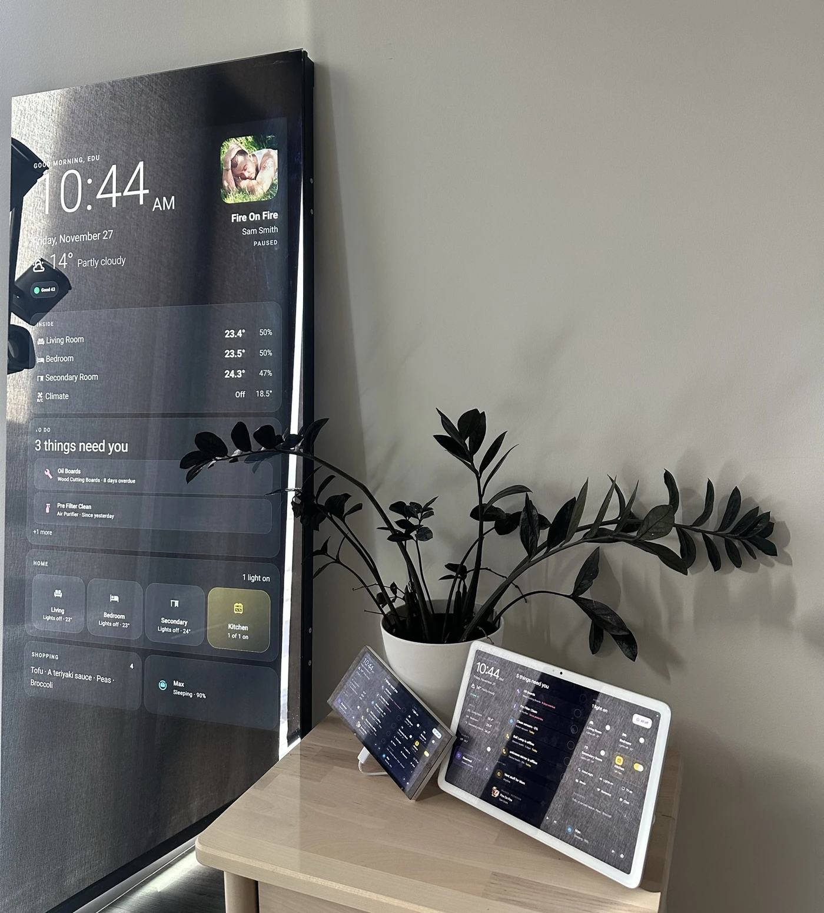

<!--
Draft. Text in [brackets] waits on the release; fill it from CHANGELOG.md, each frame's frame.json,
and each pane's pane.json on the day it goes out. The date in the folder name and `date:` is a
placeholder too.
-->

Today, I'm super excited to share **Glassworks 1.0** [version, link to the release].

Glassworks is an open-source panel core that turns wall switches, smart mirrors, and Android tablets into dedicated Home Assistant devices. It boots straight into your own Home Assistant dashboard full screen and shows up in Home Assistant as a single native ESPHome device—with local voice, synced multi-room audio, built-in Zigbee/Thread radios, and updates right under *Settings → Updates*. Nothing to install in Home Assistant, no cloud, and no account with us.

This has been a labor of love, and before getting into everything in 1.0, I want to share how the project started—because it explains a lot of the decisions behind it.

## How I ended up building this

I've been running Home Assistant since 2020, and I've spent way too many evenings dialing in my dashboards. For a long time, the main place I actually saw them was on my phone. A wall panel is supposed to fix that: it's the one screen in the house everyone touches, whether they care about Home Assistant or just want to turn off the kitchen lights.

My first wall panel was a Pixel Tablet. To get it working the way I wanted, I ran a kiosk app for the dashboard alongside a separate IP camera app just so Home Assistant could tell when someone walked up to the screen. It worked, sort of—except every time I turned on the room lights, the motion detector thought someone had walked up to the tablet. I ended up taking an open-source camera app and rewriting its motion detection to ignore lighting changes. What surprised me was how many community presence setups have that exact same bug: flip a light switch and they all trigger. That detector is now what powers Glassworks' camera presence.

Then I picked up an Aqara Panel Hub S1 Plus. Hardware-wise, it was everything I wanted: a sharp touchscreen, mics, a speaker, a time-of-flight presence sensor, and a Zigbee/Thread radio in a unit that replaces a standard light switch. Then I turned it on and ran straight into Aqara's launcher, Aqara's cloud, and a system WebView so old it couldn't even load Home Assistant. It was completely locked down—nobody had managed to get Home Assistant or custom software running on it.

So I spent a weekend figuring out how to get it into the chip's recovery mode and boot my own code from RAM. I taped wires to the UART pads to get a serial console, then spent literal hours banging my head against the wall trying different DRAM timing combinations to figure out what we were missing. It was the only thing I could think about—and right when I was about to give up, after a lot of trial and error, it finally came up. By the next day it was showing my dashboard and responding to a wake word.

After that, I got a lululemon Studio Mirror and tried to do the same thing, and that's where I hit a different wall. The existing options were permanently destructive one-way flashes with no way back to stock firmware, and they wanted me to use their own dashboards, so I had to hack around them just to show mine. Installing anything felt like crossing my fingers while commands scrolled past with no idea whether it was succeeding or about to brick the device.

The more wall-panel projects I looked at, the more I saw the same pattern: every project was building its own ecosystem—custom management portals, custom home screens, dozens of obscure settings, manual updates, and inconsistent UIs. I care a lot about clean, simple software, and all of it felt overbuilt.

Worse, most of it was reinventing things Home Assistant already does really well. Dashboards, automations, voice, music, user permissions—Home Assistant already handles roughly 90% of what a wall panel needs. **The panel itself only needs to do the remaining 10%: hand Home Assistant the hardware it doesn't have** (the display, mics, speaker, sensors, and radios) and stay out of the way.

Right now, Home Assistant wall panels mostly fall into two camps: locked vendor displays that stop working the day a company pivots, or DIY tablets fighting a browser engine. Glassworks is a bet on a third path—one open, hardware-neutral core that treats Home Assistant as the only brain, handles the small annoying details (like light switches not counting as people), installs from a browser tab, measures itself honestly in public, and outlives the company that made the hardware.

## What's in 1.0

Here's what you get today.

**Your own dashboard.** Glassworks renders the Home Assistant dashboard you already built, full screen, without forcing a custom launcher or dashboard designer on you. The only UI Glassworks draws itself is what only the panel can handle—setup, voice feedback, timers, and notifications—and those screens look consistent across every device.

**One native ESPHome device.** Your panel joins Home Assistant as a standard ESPHome device. Adopt it and you're done: no HACS integration, no cloud service, and no account. Every sensor and setting shows up as a normal entity you can use in automations and scripts.

**Browser-based install with [Kiln](https://kiln.glassworks.dev).** Plug your panel into your computer over USB, open Chrome or Edge, and Kiln walks you through the install step by step. Every download is verified, flashable wall panels back up their stock software first with a guided way to restore it anytime, and on the Studio Mirror Kiln now supports both a browser-based **stock-in-place patcher** (keeping a true restore point back to stock firmware) and installing the community Glass Panes image. At 1.0, Kiln installs Glassworks on the Aqara S1 Plus, the lululemon Studio Mirror, and any Android device.

**Automatic updates through Home Assistant.** New releases appear under *Settings → Updates* alongside the rest of your devices. Tap update, or automate it.

**Modular features ("panes").** Hardware capabilities are packaged as panes, and a device only exposes the ones its hardware supports. At 1.0, every pane is **stable** except the S1's wired wall base:

- **Assist voice & Timers** — on-device `microWakeWord` detection handing straight off to Home Assistant Assist, plus on-screen voice timers.
- **Music (Sendspin)** — synced multi-room playback straight from Music Assistant.
- **Camera presence** — lighting-invariant motion wake, snapshots, and an optional ONVIF stream.
- **Zigbee / Thread radio** — exposes a built-in Silicon Labs chip as a Zigbee coordinator, Thread border router, or network repeater.
- **Bluetooth proxy & Notifications** — active BLE proxy plus rich on-screen notifications with pictures, action buttons, and sounds.
- **Diagnostics** — CPU, temperature, RAM, storage, Wi-Fi, and uptime in Home Assistant.
- **Wall base** *(alpha, S1 Plus)* — relays and sensors on the S1's wired wall base.

Optional panes like the Bluetooth proxy and camera stay off until you turn them on, and every pane can be toggled anytime so features you don't use never eat memory or CPU.

**Honest performance grades with [Clarity](../../../docs/clarity.md).** Spec sheets don't tell you whether a wall panel will actually feel snappy with a real Home Assistant dashboard. So we built Clarity—a standardized, open benchmark that runs the real HA frontend on every device and gives it a public grade from A+ to E. The S1 Plus scores **D** (best kept to light dashboards; typical dashboards block the browser's main thread for 2.7 seconds). If a piece of hardware has limits, you should know before you buy it or mount it on a wall. <!-- Once /blog/clarity publishes, add: I wrote a separate post about how Clarity works: [Introducing Clarity](https://www.glassworks.dev/blog/clarity). -->

**Supported devices ("frames") at 1.0** — all **stable**:

- **[Aqara Panel Hub S1 Plus](../../../frames/aqara-s1-plus/README.md)** — the reference device where Glassworks started and where every feature lands first. Clarity grade **D**.
- **[lululemon Studio Mirror](../../../frames/lululemon-mirror/README.md)** — a 40-inch display behind a full-length mirror, installed via the community Glass Panes image or Kiln's stock-in-place patcher (with Device Owner silent updates and a true restore point back to stock). Clarity grade **E** on the web path.
- **[Generic Android](../../../frames/generic-android/README.md)** — a no-root app for whatever Android tablet you already have, tested on the [Google Pixel Tablet](../../../frames/google-pixel-tablet/README.md) (Clarity grade **B**) and a 2016 [Samsung Galaxy Tab A 10.1](../../../frames/samsung-galaxy-tab-a-10-1-2016/README.md) running LineageOS.

## Cracking open locked hardware—with a road back to stock

Glassworks isn't just an Android app. A huge part of this project is the low-level hardware research underneath it—and neither the Aqara S1 Plus nor the lululemon Studio Mirror could be modified this way before. Through our own research, both devices now have a non-destructive path and a full road back to stock.

### Aqara Panel Hub S1 Plus: unlocked from scratch

Out of the box, the S1 Plus was completely sealed—nobody had managed to run Home Assistant or custom software on it before. Starting from the Allwinner A133's USB recovery mode (FEL), taped UART serial wires, and hours of DRAM timing trials, we brought up our own RAM-booted code, mapped the full boot chain, reverse-engineered the wall-base serial protocol and Zigbee/Thread radio, and turned all of it into a guided browser install in Kiln. Before Kiln writes a single byte, it backs up your stock partitions, verifies every write, and keeps a full path back to stock Aqara firmware. Every step is documented in [the S1 Plus research notes](../../../frames/aqara-s1-plus/README.md#research-notes).

### lululemon Studio Mirror: breaking open a black box

Until now, modifying a lululemon Studio Mirror meant flashing an entire replacement system image—a permanently destructive, one-way edit that left you with no way to bring the Mirror back to stock. The untouched stock firmware itself was a black box: the bootloader is locked, fastboot cannot read partitions back, there is no touchscreen to approve a USB debugging prompt, and stock `adbd` ignores user keys. Nobody had been able to pull the full stock system off a Mirror.

Here is how we cracked it open:

1. **A `userdata`-only probe app.** We took advantage of fastboot letting us flash `userdata` with a small probe app that Android automatically installs and launches on boot—no touchscreen and no ADB required—exposing a tiny server over the Mirror's own setup Wi-Fi network.
2. **Mapping the live system.** Over the network, that probe pulled readable parts of `/system`, the live SELinux policy, and the exact physical disk blocks where system files live on eMMC. That alone was enough to surgically patch a single file (`services.jar`) in place—saving the original blocks first—and open authorized USB debugging while leaving the rest of the system untouched.
3. **Pulling the entire stock `system` and `boot` images.** That still left parts of `/system` and the `boot` partition out of reach. Using what the probe uncovered in the security policy, we found a system process (`dpmd`) running as `root` with permission to load kernel modules, hooked one of its libraries to load a small kernel module, and streamed out the complete, untouched raw `system` and `boot` images from a stock Mirror—something nobody had been able to do before—before restoring everything back to stock.

Opening up that black box unlocked Kiln's **stock-in-place** mode for the Mirror. Instead of wiping lululemon's software forever, Kiln keeps the stock system intact, patches only the exact blocks needed for USB setup and silent Device Owner updates, hides lululemon's apps, and saves a byte-exact restore point that puts the Mirror right back to stock. The full investigation—including the dead ends—is written up in [the stock Mirror probe research note](../../../frames/lululemon-mirror/research/stock-firmware-probe.md).

## Standing on community work—and giving back

Alongside our own hardware research, Glassworks stands on a lot of people who did hard work before us. On the lululemon Mirror, alongside our new stock-in-place path, Kiln also installs the [Glass Panes](https://github.com/git-nimrod/glass-panes) image by git-nimrod, which builds on work from Onemoremichael, lrinQVQ, TimStewartJ, repairman29, porcuswine, vgab7, and others, plus research and teardowns from repairman29, Onemoremichael, olm3ca, and MDME. On the S1 Plus, Kiln builds on [sunxi-tools](https://github.com/linux-sunxi/sunxi-tools) and [Magisk](https://github.com/topjohnwu/Magisk).

The goal was never to overwrite that work—it's to bring it together in one reliable installer and app so the next person doesn't have to piece together five GitHub repos and a 400-post forum thread. Every frame credits the people it builds on in its docs, on glassworks.dev, and inside Kiln.

We're also pushing everything we build and learn back out:

- **Standalone MIT libraries.** The protocol code isn't locked inside Glassworks. Our [ESPHome API client](../../../libs/esphome-api/README.md) (published on Maven Central), [Improv](../../../libs/improv/README.md), [Sendspin](../../../libs/sendspin/README.md), [Bluetooth proxy](../../../libs/bluetooth-proxy/README.md), and [voice](../../../libs/voice/README.md) libraries can all be dropped into other projects as-is.
- **Upstream fixes.** Whenever we ran into a bug in an upstream dependency, we sent the fix upstream rather than hacking around it:
  - **Home Assistant Zigbee ([zigpy/bellows#774](https://github.com/zigpy/bellows/pull/774), merged):** fixed a hang when creating a new Zigbee network or restoring a backup on certain Silicon Labs radios.
  - **Home Assistant Voice ([home-assistant/core#192714](https://github.com/home-assistant/core/pull/192714)):** fixed an issue where an ESPHome satellite's wake word selector dropped changes made on the device. <!-- Update if merged before release. -->
  - **U-Boot:** submitted a DDR4 initialization fix discovered on the S1 Plus to the U-Boot mailing list, which should help other Allwinner A133 DDR4 boards too. <!-- Update if merged before release. -->
  - **Glass Panes ([git-nimrod/glass-panes#5](https://github.com/git-nimrod/glass-panes/issues/5)):** tested the community Mirror image on an unreported board revision and shared the findings back.
- **Open hardware research.** Reverse-engineering a locked device is the hardest part of this work, and too much of it usually disappears into Discord scrollback. We've documented every finding in [the research notes](../../../docs/research/README.md) (61 of them at 1.0)—exact commands, outputs, dead ends, and confidence levels, covering everything from the S1 boot chain, DDR4 fix, and wall-base serial protocol to Mirror board revisions and stock-in-place patching on Android 6. We ask the same of anyone contributing a new frame ([CONTRIBUTING.md](../../../CONTRIBUTING.md)): publish the research alongside the PR so the whole community can build on it.

**A quick note on licensing:** the standalone libraries are **MIT** (use them however you want), and Glassworks Core is **MPL-2.0**. Because MPL-2.0 is file-level, you can build your own product or commercial hardware on top of Glassworks, while any improvements to Glassworks core files stay open for everyone. Wall hardware stays mounted for years—usually longer than a vendor's cloud survives—and open code is the only way it lasts.

## What's next: 1.1, 1.2 and 1.3

1.0 is a starting line, not a finish line. Every panel on 1.0 updates itself right under *Settings → Updates*, and we already know where we're headed next:

- **1.1 — [Vitro](https://github.com/GlassworksHQ/glassworks/issues/790).** What if your wall panel didn't need a browser at all? Your existing Home Assistant dashboard, drawn natively—starting in *Settings → Labs*.
- **1.2 — [Shards & third-party Vitro cards](https://github.com/GlassworksHQ/glassworks/issues/940).** Screensavers, photo frames, custom voice skins, intercom—and HACS cards running natively in Vitro—without bloating Core.
- **1.3 — [Shard marketplace](https://github.com/GlassworksHQ/glassworks/issues/941).** Browse, install, and update community Shards straight from your panel's Manage page.

Outside of any version number, **new frames keep landing in Kiln continuously** as devices are brought up. If you want the full technical details, everything is in the open on our [GitHub milestones](https://github.com/GlassworksHQ/glassworks/milestones).

## Help shape what comes next

I'd love to hear from you as people start running 1.0 on real walls:

- **What device should we support next?** If you have a smart display, an old tablet, or a locked-down wall panel sitting in a drawer, tell us what it is (and what's inside it, if you know).
- **What panes are missing?** What do you wish your wall panel exposed to Home Assistant?
- **What rough edges did you hit on day one?** The small annoyances matter most—let us know what felt clunky or broke your expectations.

I want the community to shape what comes next. I'd love to collaborate with hardware makers and maintainers who already have custom device images but don't have a great Home Assistant panel app to run on them—and I'm happy to host community images right in Kiln so people can install whatever they want cleanly from the browser.

Join us on [Discord](https://discord.gg/hHpf77fBMj), drop ideas in [GitHub Discussions](https://github.com/GlassworksHQ/glassworks/discussions), or open a [feature request](https://github.com/GlassworksHQ/glassworks/issues/new?template=feature.yml).

And if you enjoy cracking open hardware and want to bring up a new device, come build a frame with us. The core app, panes, Kiln engine, and research templates are already there—check out [how frames work](../../../frames/README.md) and [CONTRIBUTING.md](../../../CONTRIBUTING.md) to get started. Or if you want to take Glassworks and build your own custom hardware or product around it, go for it—I'd love to see what you build.

## Try it out

Head to **[Kiln](https://kiln.glassworks.dev)** to install Glassworks, or read the [project principles](../../../docs/principles.md) if you want the full design philosophy behind it.

Huge thanks to everyone who ran early test builds on real walls, filed bugs, or helped reverse-engineer hardware along the way. [Credits.] This is only the beginning, and I'm so glad you're here for it—put your dashboard on the wall and let me know what you think!

Eduardo
