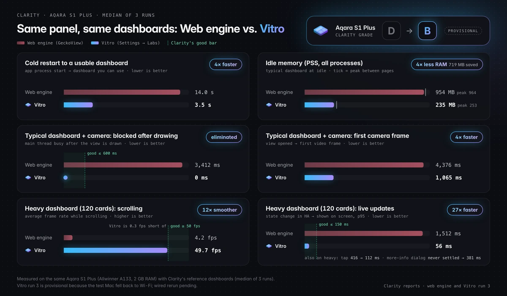

<!--
Draft. Goes out with Glassworks 1.1, the release Vitro lands in (not 1.0), once #799 and #980 are
on main (which also adds the `/blueprints#vitro-check` compatibility checker referenced below) and
the official post-#980 S1, Pixel Tablet, and Mirror (#796) Vitro Clarity runs finish.
Current S1 Vitro numbers below come from run 19 on the #980 test build (WebRTC cameras) compared
against the committed s1cam3 GeckoView run (HLS cameras); swap in the official same-branch S1
re-grade + RAM numbers (and Mirror/tablet numbers) and regenerate performance-comparison.webp if
any digit shifts before publishing.
Text in [brackets] waits on release day. Once `exp/vitro` merges to `main`, update the GitHub links
to relative repo links (`../../../engines/engine-vitro/README.md`, `../../../docs/vitro.md`,
`../../../docs/engine-contract.md`, `../../../docs/research/vitro-island-census.md`).
-->

For years, every Home Assistant wall panel app has been running the same race: wrap a WebView around Home Assistant's web frontend, pile on kiosk settings, and hope the tablet has enough CPU and RAM to keep up.

Some apps are really good at that. If you mount a recent flagship tablet on the wall and want a feature-packed WebView app, you already have great options.

**We stepped out of that race altogether.**

When we introduced [Clarity](https://www.glassworks.dev/blog/clarity)—our open performance benchmark for Home Assistant wall panels—we graded our own flagship panel first. On the web engine, the Aqara Panel Hub S1 Plus scored a **D**. It is a 32-bit, quad-core Cortex-A53 light switch with 2 GB of RAM running Android 10, and keeping a modern JavaScript frontend alive on it ate **954 MB of RAM across all processes** at idle. Throw our 120-card, four-camera heavy dashboard at it, and the view took **35.7 seconds** just to open and scrolled at **5.7 frames per second**. The lululemon Studio Mirror, with 930 MB of RAM on Android 6, scored an **E** and ran out of memory on the heavy dashboard altogether.

That honest **D** forced the only question that mattered: was the hardware really too slow to run a smart home dashboard, or was a desktop browser engine just the wrong thing to put on a light switch?

In **Glassworks 1.1** [link to the release], we are introducing **Vitro** under **Settings → Labs**: a native Android rendering engine for the Home Assistant dashboard you already built. No browser process, no custom Home Assistant integration, and no rebuilding your screens in someone else's editor.

On the exact same Aqara S1 Plus and the exact same benchmark, Vitro did not just lift the panel a letter grade. It maxed out Clarity's grading scale—moving the S1 Plus from **D** to **A+ premium**, opening that 120-card heavy view in **0.36 seconds** (~100× faster) and scrolling it at **57.8 frames per second** with four live WebRTC cameras running.

## No more choosing between fast and yours

Until now, putting Home Assistant on a wall meant picking between two compromises:

1. **Browser and WebView kiosk apps:** Full compatibility with your Lovelace dashboards, at the cost of dragging a 500–950 MB browser engine onto a light switch—slow cold starts, janky scrolls, memory pressure, and outdated system WebViews on older Android hardware.
2. **"Native" panel apps and microcontroller screens:** Fast and lean, at the cost of throwing away your Home Assistant dashboards and rebuilding every screen inside a separate editor or custom YAML format.

Vitro removes that tradeoff. It connects straight to Home Assistant's WebSocket API in Kotlin, reads the Lovelace dashboard you already have—layouts, themes, custom fonts, templates, and history—and draws it natively with Android views and Canvas.

Your dashboard stays in Home Assistant, and nothing gets installed there ([the principles](../../../docs/principles.md)). The only layer that disappears is the browser sitting between Home Assistant and the glass.

[Your own aha moment in 2–3 lines: e.g., watching the S1 Plus jump from a 5.7 fps slide show to locked 58 fps with four live cameras, or seeing your real dashboard render identically with zero GeckoView processes in `ps`.]

## How Vitro works: three automatic tiers

Pulling this off on real dashboards means accepting reality: Home Assistant's ecosystem is huge, and plenty of setups mix core cards, HACS favorites, and one or two exotic custom cards. Vitro handles that automatically with three tiers:

| Tier | What it handles | How it renders |
|---|---|---|
| **Tier 1: Native core** | Layouts (`sections`, `masonry`, `panel`, `grid`, stacks, `visibility`), **32 built-in Home Assistant cards**, native More-Info dialogs, native **WebRTC / HLS / MJPEG** cameras, 14 inline tile features, themes, custom fonts, and all **7,447 MDI icons** | Native Android views and Canvas: zero JavaScript and zero browser process |
| **Tier 2: Native HACS fast-paths** | **30 popular HACS cards**: the entire Mushroom suite (16 cards), `custom:button-card` (standard configs without JS templates), Bubble Card, `mini-graph-card`, `mini-media-player`, `clock-weather-card`, `modern-circular-gauge`, `bar-card`, `weather-card`, `swipe-card`, `auto-entities`, `stack-in-card`, `vertical-stack-in-card`, and `layout-card` | Native Kotlin renderers, using Home Assistant's own `render_template` subscriptions for Jinja2 |
| **Tier 3: Micro-Islands** | Any other `custom:*` card, JS-templated custom cards, or any custom card using CSS or options Vitro can't match faithfully | A tiny isolated GeckoView micro-island served from loopback (`127.0.0.1`) with a `hass` proxy shim, shared storage, and your resolved theme variables |

Two architectural decisions make this hold up on real panels:

- **Zero browser until a card actually needs one.** If your dashboard stays in Tier 1 and Tier 2, **GeckoView never even starts**. There is no tab process, no browser GPU process, and no JavaScript runtime consuming your panel's RAM.
- **Zero dependence on Android's system WebView.** Even when a card drops into a Tier 3 island, Vitro never touches `android.webkit.WebView`, which is missing or frozen on ancient Chromium builds on hardware like the S1 Plus and the Mirror. Only that single card pays for a micro-island, and because Vitro passes your resolved theme variables into it, it blends seamlessly into the native cards around it.

The smaller interactions stay native too. Tapping or holding a tile opens native More-Info dialogs modeled after Home Assistant: an HSV color wheel and Kelvin picker for lights, a circular thermostat dial, a cover position slider, a 24-hour stepped sensor graph, live camera playback (up to four WebRTC feeds at once), and an alarm PIN pad. Themes resolve recursive `var(--...)` chains, gradients, and shadows natively, and custom `@font-face` and Google Fonts stylesheets from your Lovelace resources are fetched and cached right on the panel.

## "Home Assistant's own render is the spec"

The reason nobody has pulled off a general native Lovelace renderer before isn't that drawing a toggle button is hard. It's that **85% visual parity feels broken**. If padding is off, a Markdown table collapses, or a `card_mod` sheet behaves differently than it does in Chrome, you stop trusting the panel immediately.

So we set one non-negotiable rule: **Home Assistant's own browser render is the spec.**

- If Home Assistant draws a card, graph, font, or supported `card_mod` rule a certain way, Vitro matches it closely enough that you can't tell them apart at a glance.
- If Home Assistant strips something—like inline `style=` attributes in Markdown—Vitro strips it too, so you never build a dashboard that only looks right on one engine.
- If a custom card uses something Vitro can't draw faithfully, Vitro refuses to fake it and routes that card to a Tier 3 micro-island instead.

We don't eyeball that bar. Every pull request runs an automated **visual parity harness** (`tools/vitro-parity`) in CI: **135 card and layout cases** rendered twice—once in headless Chromium running Home Assistant's real frontend, and once in Vitro at the exact screen sizes and densities of the S1 Plus, the Mirror, and a tablet. It diffs every case on pixels, card bounds, and font sizes, and fails CI whenever a card drifts.

<!-- [Add side-by-side screenshot here: Home Assistant in Chrome (left) vs. Vitro on the lululemon Mirror or Aqara S1 Plus (right). Caption: "Try telling which side is Chrome and which side is native Android."] -->

## From D to A+ premium on the exact same wall switch

Dropping GeckoView got us most of the way there, because it wiped out the browser's RAM overhead and JavaScript main-thread stalls. Reaching **A+ premium** on a 1.5 GHz quad-core Cortex-A53 with 120 cards and four live cameras took owning the whole rendering pipeline end to end:

- **View-scoped subscriptions and `O(changed)` updates:** Vitro subscribes only to the entities on the active view, and when one sensor ticks, `EntityStore` updates only the card bound to it instead of propagating a full state map through a DOM tree.
- **Keep-alive view cache:** Switching dashboard tabs flips visibility on pre-built native views rather than tearing down and rebuilding cards from scratch.
- **Viewport culling on long dashboards:** On a 120-card view spanning 17 screens, Android's `RenderThread` used to spend most of each frame walking render nodes for cards far off screen. Vitro skips off-screen cards in each column's draw pass while keeping layout heights and camera surfaces intact, catching up any queued state updates before a card scrolls back into view.
- **Corner-only card clipping and local relayouts:** Rounded cards skip expensive hardware outline clipping when their content never reaches the rounded corners, and live text updates on entity, sensor, and glance cards lay out only themselves instead of invalidating the whole dashboard.

Clarity grades Vitro under the **exact same rubric and reference dashboards** as the web engine—same local mock Home Assistant, same taps, swipes, live state stream, cameras, and More-Info dialogs.

<!--
[Embed the S1 side-by-side video here once video support lands in site/src/lib/docs/render.ts
(currently sanitized out) and the final 1.1 cut is refreshed from
C:\Users\Eduardo\scratch\vitro-video\compose\vitro-vs-web-cut-1280.mp4 (76 s, 5.1 MB, on METIS):
Part 1 heavy cold start + first tap, Part 2 14 s real-time heavy scroll with live fps counters,
Part 3–4 theme switch & native cards, count-up summary. Refresh on final 1.1 build so Bubble Card
and mini-graph-card can also be included in Part 4.]
-->

Here is what changed on the **Aqara S1 Plus** (Allwinner A133, 2 GB RAM, Android 10) running Clarity's heavy (120 cards, 4 live cameras) and typical reference dashboards:

| Metric (Aqara S1 Plus) | Web engine (GeckoView) | Vitro (Labs) | Improvement |
|---|---|---|---|
| **Clarity grade** | **D** *(light dashboards)* | **A+ premium** *(all four tiers)* | **Top possible grade** |
| **Heavy: open the view** | 35.7 s | **0.36 s** | **~100× faster** |
| **Heavy: scrolling** | 5.7 fps *(p95 350 ms)* | **57.8 fps** *(p95 16.7 ms)* | **~10× smoother** |
| **Heavy: tap latency** | 288 ms | **72 ms** | **4× faster** |
| **Heavy: live state change** | 739 ms | **62 ms** *(p95)* | **12× faster** |
| **Heavy: camera frames shown** | 35% | **98.4%** | **Near-complete playback** |
| **Heavy: camera stalls** | 26.6 s | **0.67 s** | **40× fewer stalls** |
| **Heavy: first camera frame** | 3.7 s | **1.4 s** | **2.6× faster** |
| **Typical: open the view** | 6.6 s | **0.24 s** | **27× faster** |
| **Typical: scrolling** | 25.0 fps | **59.3 fps** | **2.4× smoother** |

Look at that scroll number again: **57.8 fps with a 16.7 ms p95 frame time** on the 120-card, four-camera heavy benchmark. At 60 Hz, one display frame is 16.7 milliseconds. On a light switch that used to take 35.7 seconds just to open that view and stall its cameras for 26.6 seconds, Vitro now opens it in 360 milliseconds and keeps 98.4% of live camera frames flowing on time—while cutting app memory roughly 4× compared to the web engine's 954 MB footprint.

*[Add final official post-merge S1 RAM/restart numbers, Pixel Tablet comparison, and lululemon Mirror before/after numbers once the official re-grades finish.]*

### Saturating the grade, not the measurements

Because **A+ premium** is Clarity's ceiling, Vitro on the Aqara S1 Plus literally saturated the letter grade we designed to keep ourselves honest.

That is also why Clarity publishes raw measurements alongside the letter. Even at **A+ premium**, the report still tells us exactly where the S1 Plus has room to get even faster: the main thread stays busy for **332 ms** right after opening the 120-card heavy view (below the 600 ms poor cutoff, but still flagged as needs-improvement), a full cold restart takes **3.9 seconds** to reach a usable dashboard (down from 14.0 seconds on GeckoView), and one of the four simultaneous cameras took 4.2 seconds for its first frame. Clarity doesn't let an A+ hide real bottlenecks—and it gives us clear targets for what comes next.

## Built on data, not guesswork

Instead of guessing which cards matter next, we ran a census across **60 real community Home Assistant dashboards** from GitHub ([read the island census](https://github.com/GlassworksHQ/glassworks/blob/main/docs/research/vitro-island-census.md)).

Even before our latest wave of HACS cards, **~77% of cards** in those community dashboards were already native—and nearly half of the remaining islands came from a single card (`custom:button-card`), plus `entity-button`, `mushroom-empty-card`, `weather-card`, and `swipe-card`. We've already built native renderers for all five in Vitro, cutting the remaining community island share roughly in half.

And for the long tail of custom cards, two things are on the way:

- In **Glassworks 1.2**, **[third-party Vitro cards](https://github.com/GlassworksHQ/glassworks/issues/940)** will let HACS authors ship native Vitro support right inside their existing cards, with no Android tooling required.
- For inherently web content like `map`, `iframe`, and `energy-*` (plus custom cards without a native driver), Vitro sits cleanly behind Glassworks' [`Engine` contract](https://github.com/GlassworksHQ/glassworks/blob/main/docs/engine-contract.md), so we can swap in a lighter island engine behind that seam later without touching a single native card or pane.

## Where this puts Glassworks

Put the three pieces together:

- **[Kiln](https://kiln.glassworks.dev)** unlocks locked wall hardware from a browser tab, with verified backups and a way back to stock.
- **Glassworks' MPL-2.0 open core** turns that hardware into one native ESPHome device—local Assist voice, Sendspin audio, Zigbee and Thread radios, and updates right inside Home Assistant.
- **Vitro** removes the browser itself, turning a D-grade light switch into an A+ Home Assistant panel without changing a line of your dashboard.

When a $140 32-bit wall switch can open a 120-card Home Assistant dashboard in 0.36 seconds and scroll it at 58 fps with four live cameras, the question stops being *"which kiosk app has the most WebView tweaks?"*—it becomes *"why is my wall panel running a desktop browser at all?"*

## Try it today—zero risk

You don't even have to touch a panel to see how your dashboard fares:

1. **Test your dashboard right in your browser.** Paste your Lovelace YAML or JSON into the **[Vitro compatibility checker](https://www.glassworks.dev/blueprints#vitro-check)** on `glassworks.dev/blueprints`. It runs 100% client-side—nothing leaves your machine—and tells you card by card what renders natively and what triggers an island. There is also a copyable prompt right above it if you want to convert a custom JS card to pure Vitro-native YAML.
2. **Flip the switch in Labs.** On any Glassworks 1.1 panel (or from its Manage page), open **Settings → Labs** and enable **Vitro renderer**. The app restarts into Vitro. It's experimental and off by default—turn it off anytime and you're immediately back on GeckoView, with nothing touched in Home Assistant.

Vitro gets better with every real dashboard we throw at it. Try yours, send us any card that looks even slightly off compared to Home Assistant, and come talk about it in [GitHub Discussions](https://github.com/GlassworksHQ/glassworks/discussions) or on [Discord](https://discord.gg/hHpf77fBMj).

Eduardo
